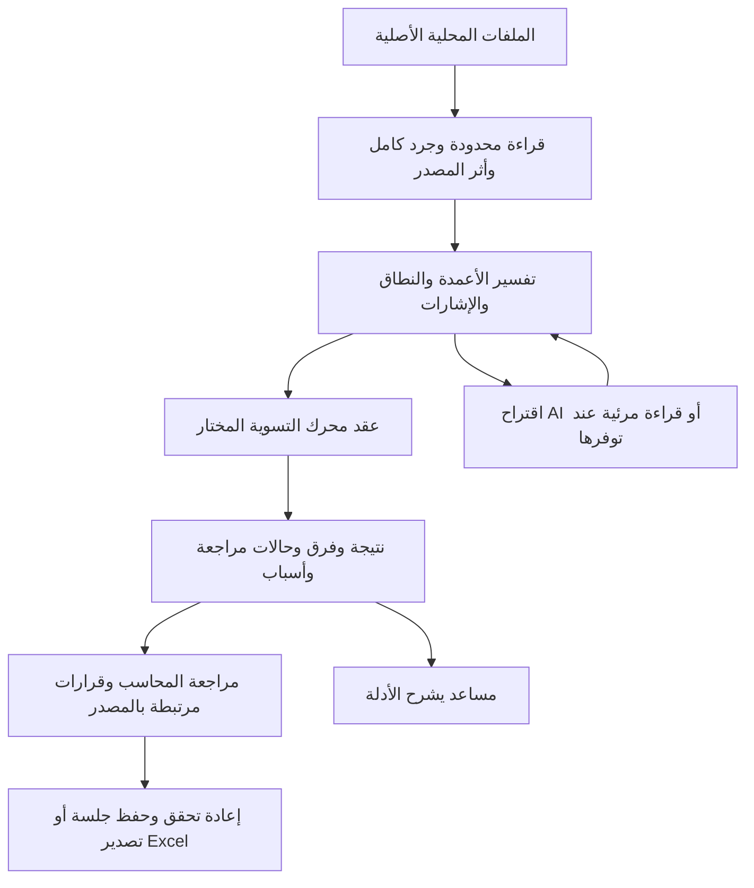

# هيكلة تراصف ومسار البيانات

## البنية الحالية

تطبيق React وTypeScript يبنى بـVite ويستضاف كملفات ثابتة على GitHub Pages. وجود مجلد `app` لا يعني أن التطبيق يستخدم خادم Next.js. [vite.config.ts](../../vite.config.ts) يضبط المسارات النسبية للبناء والعامل، و[main.tsx](../../main.tsx) نقطة الدخول. [package.json](../../package.json) وملف القفل مصدر إصدارات الاعتمادات؛ [سير النشر](../../.github/workflows/pages.yml) يثبت بيئة CI.

السهم العائد من AI يعني تحققًا من اقتراح غير موثوق؛ لا قناة تختصر العقد إلى نتيجة معتمدة. فحص الحساب لا يكفي وحده لإثبات معنى عمود أو علاقة مستند.

## خريطة الشفرة

| الطبقة             | المواقع                                                                                                                                                                                                                      | المسؤولية                                                                   |
| ------------------ | ---------------------------------------------------------------------------------------------------------------------------------------------------------------------------------------------------------------------------- | --------------------------------------------------------------------------- |
| الصفحة والتنقل     | [app/page.tsx](../../app/page.tsx)، [reconciliation-navigation](../../components/reconciliation-navigation.tsx)، [workspace-chrome](../../components/workspace-chrome.tsx)                                                   | اختيار النوع، العمل المحفوظ، قفل التنقل أثناء المعالجة، مصدر الإدخال الأصلي |
| الهوية والمشهد     | [brand](../../components/brand.tsx)، [document-scene](../../components/document-scene.tsx)، [source-upload](../../components/source-upload.tsx)، [landing](../../components/landing.tsx)                                     | عرض مشترك مستقل عن القرار المحاسبي                                          |
| الترجمة            | [lib/i18n](../../lib/i18n)، [directory](../../lib/i18n/reconciliation-directory.ts)                                                                                                                                          | نصوص AR/EN وأسماء المجالات، لا قواعد مالية مترجمة                           |
| القراءة الأصلية    | [io.ts](../../lib/reconciliation/io.ts)، [pdf.ts](../../lib/reconciliation/pdf.ts)، [xlsx-display.ts](../../lib/reconciliation/xlsx-display.ts)                                                                              | حدود الموارد، النص والقيم والظهور والإحداثيات والأخطاء                      |
| العائلات والتفسير  | [header-view](../../lib/reconciliation/header-view.ts)، [split-section](../../lib/reconciliation/split-section.ts)، [running-balance](../../lib/reconciliation/running-balance.ts)، ملفات `*-source` و`*-native`             | ربط بنية المصدر بالعقد وإبقاء أصل الاستنتاج                                 |
| حساب المورد        | [core](../../lib/reconciliation/core.ts)، [supplier-reconciliation](../../lib/reconciliation/supplier-reconciliation.ts)، [cases](../../lib/reconciliation/cases.ts)                                                         | المقارنة والحالات وأدلة المطابقة                                            |
| المجموعات          | [invoice-group-search](../../lib/reconciliation/invoice-group-search.ts)، [invoice-overlap-search](../../lib/reconciliation/invoice-overlap-search.ts)، [payment-components](../../lib/reconciliation/payment-components.ts) | العضوية والتنافس والسعة والعلاقات، لا subset-sum وحده                       |
| المجالات الأخرى    | ملفات المحركات المسماة في [الخطط](../roadmap/README.ar.md) وملفات `*-io.ts`                                                                                                                                                  | نطاق وسياسة وحفظ وتصدير خاص بكل مجال                                        |
| العامل وحدود الثقة | [worker](../../lib/reconciliation/worker.ts)، [worker-client](../../lib/reconciliation/worker-client.ts)، [protocol](../../lib/reconciliation/protocol.ts)، [source-boundary](../../lib/reconciliation/source-boundary.ts)   | طلبات محدودة، إلغاء، ربط الرد بالمصدر والسياق، منع الرد المتأخر أو الأجنبي  |
| الجلسة والتصدير    | [session](../../lib/reconciliation/session.ts)، [case-workbook](../../lib/reconciliation/case-workbook.ts)، [export-text](../../lib/reconciliation/export-text.ts)، `*-io.ts`                                                | إعادة القراءة والحساب، أثر القرار، حفظ النص والقيم وعدم تنفيذ المصدر كصيغ   |
| المساعد والمرئيات  | [assistant](../../lib/reconciliation/assistant.ts)، [domain-assistant](../../lib/reconciliation/domain-assistant.ts)، `visual-*` و`local-*ai.ts`                                                                             | تفسير الأدلة واقتراحات مقيدة ومراجعة مرتبطة بالصورة                         |
| التحقق             | [tests](../../tests)، [audit](../../audit)، [scripts](../../scripts)                                                                                                                                                         | وحدات وعقود وأوراكل وصادرات وطفرات ومتصفح                                   |

## قواعد التكامل

1. يلتقط الطلب المصدر والسياق قبل الانتظار؛ لا تستبدل بايتات الأصل بمخبأ أوراق قابل للتغيير.
2. لكل قيمة أصل يمكن تحديده: ملف وبصمة وورقة/صف/خلية أو صفحة/موضع، مع النص الأصلي والقيمة المفسرة وسبب التحويل عند وجوده.
3. صف غير صالح له مكان وسبب. صف مجموع أو ترحيل لا يختفي؛ يسجل دوره وسبب عدم معاملته كحركة.
4. العملة ودقتها والإشارة والتاريخ ودور الرقم جزء من العقد. لا تستخدم تقريبًا صامتًا أو رقم عرض منسقًا كأصل مالي.
5. تغيير الملف أو القراءة أو النطاق يبطل القرارات التي تعتمد عليها. الاستعادة والتصدير يعيدان التحقق ولا يعيدان سلطة قديمة لمجرد وجود حدث محفوظ.
6. إبقاء المجال مركبًا ومخفيًا يحفظ حالته. تغيير عنصر الغلاف نفسه قد يعيد التركيب؛ لا توحد الشكل بإفساد العمل.
7. أدوار المصادر وترتيب مصفوفة الطلب محاسبيان. ترتيب البطاقات بصري؛ اربطهما بالدور لا بالموقع.

## إضافة عائلة مصدر

اكتب الفرق عن العقد القائم: الرأس، الأقسام، الأرقام، العملة، الفترة، العضوية، المجاميع، وأين تثبت كل معلومة. اكتب الحقيقة المرجعية من المصدر قبل تنفيذ القارئ. حوّل إلى البنية الحالية فقط إذا حفظت جميع الشروط؛ وإلا أضف عائلة وإصدار جلسة صريحين. اربط الرفع ثم العامل ثم الحفظ والاستعادة ثم التصدير ثم المساعد والواجهة بالعائلة نفسها.

لا نعيد كتابة المحركات كلها في محرك عام دفعة واحدة. نشارك الأدوات عندما يتساوى معناها وتثبت الاختبارات عدم تغيير العقود؛ تبقى سياسة المورد والبنك والرواتب منفصلة حتى لو اشتركت في جمع الأرقام.

### معنى `productEnabled` في عقد الأساس المختوم

كل عقد أساس مختوم في `audit/*-foundation/contract.json` يحمل `"productEnabled": false` ومعه `status` يقول إن العقد مقترح. **الحقلان يسجلان حال المنتج يوم الختم ولا يتغيران بعده،** لأن الختم يمنع تعديلهما. فليسا حال المنتج اليوم:

- **حال كل عائلة اليوم في [STATE](STATE.ar.md) وتقرير وحدتها الأخيرة.** ففي وحدات «c» من IC-1 إلى FA-1 صار للعائلة قسم في مساحتها يصل إليه المحاسب، للقراءة والمراجعة فقط: لا قرار ولا جلسة ولا مصنف له، ولا يغير قرارات العائلة القائمة ولا جلستها ولا مصنفها.
- **وهذا القسم ليس قبولًا للعقد:** العقد يبقى مقترحًا حتى يقرر صاحب المشروع ما سماه تقرير أساسه قرارات له.
- **يحتاج تأكيد صاحب المشروع:** هل يُعد قسم المراجعة هذا «تفعيلًا في المنتج» بمعناه هو، أم يبقى القسم خلف قرار قبل النشر. هذا التعريف وصف لما في الشفرة، لا قرار عنه.

## منطقة الحسابات المستقبلية

[خطة ACC](../roadmap/accounts-privacy-business.ar.md) تقترح خدمة هوية وعضويات وحصص واشتراك ولوحة مجمعة منفصلة عن مساحة الملفات المحلية. ليست هذه مكونات البنية الحالية. تحدد الخطة الاستضافة المناسبة قبل الحسابات التجارية، وفصل الأصول وعقد الرسائل والأهلية واختبارات الشبكة، دون إرسال ملفات التسوية أو نتائجها أو بصماتها إلى المنطقة المتصلة.

إضافة الحساب لا تمنح الخادم سلطة على نتيجة المحرك، ولا تمنح مالك المنصة صلاحية الاطلاع على عمل المحاسب. لا تستخدم وعد local-first لإخفاء وجود بيانات حساب خارج الجهاز عند تفعيل الخدمة لاحقًا؛ يحدث عقد الخصوصية والدليل قبل التفعيل.

## عقد مصدر PDF قبل قراءة الجداول

تفصل [وحدة INV-1F-G1](../audits/INV1-PDF-NATIVE-SOURCE.ar.md) بين readNativePdfSource للهندسة الأصلية وreadPdf للإسقاط العام. يستعملان مجمّعًا خاصًا واحدًا مع حراس الخط والدفق والطلاء والظهور. عقد native-pdf-source-1 يحفظ SHA-256 من البايتات الملتقطة قبل الانتظار، والصفحة ورقم العنصر النصي وحدود الصفحة والمواضع والتحذيرات؛ لا يعطي دور حقل أو نتيجة مالية.

النصوص غير الفارغة فقط هي عناصر المصدر، وقد تقسم عبارة واحدة إلى عدة عناصر؛ لا يساوي رقم العنصر صفًا محاسبيًا. الإحداثيات نسبية لأسفل يسار الصفحة الظاهرة، وview يحفظ الأصل المطلق. readingIssues إلزامي في العقد، ولا يجوز تجاهله عند بناء عائلة مالية. لا يقبل API هندسة مخبأة من العميل؛ أي ربط مالي لاحق يحتاج إعادة قراءة الأصل والتحقق من ملكية الحقل والأبعاد وحدود الجدول والصفحة. لا يغيّر هذا العقد SourceFile أو بروتوكول الجلسة أو طلب المخزون ضمنيًا.

## دورة PDF المخزون في G4 وG5

الحالة الخام stock-pdf تحمل PDF السجل وثلاثة CSV للخريطة والسياسة وGL، مع الاختيارات والقرارات، ولا تحمل sheets أو هندسة أو نتيجة معتمدة من المستدعي. تبقى حالة CSV/Excel والجلسة القديمة منفصلتين. [سجل التنفيذ](../audits/INV1-PDF-WORKSPACE.ar.md) يميز المرشح المحلي من النشر.

| الجزء | المدخل والسلطة | موضع التنفيذ |
| --- | --- | --- |
| المعاينة | بايتات PDF مملوكة قبل الانتظار؛ اقتراح حرفي بلا اعتماد | [inventory-pdf-preview](../../lib/reconciliation/inventory-pdf-preview.ts) |
| النقل | أفعال وحقول وأحجام محددة، والتقاط الطلب والرد وربطهما | [inventory-pdf-request](../../lib/reconciliation/inventory-pdf-request.ts) و[lifecycle](../../lib/reconciliation/inventory-pdf-lifecycle.ts) |
| الحساب | إعادة قراءة الأصول الأربعة وحروف الهوية ثم النواة القائمة | [inventory-pdf-accounting](../../lib/reconciliation/inventory-pdf-accounting.ts) و[inventory-register](../../lib/reconciliation/inventory-register.ts) |
| الشرح | سؤال مقيد ونتيجة أعيد إثباتها؛ لا قرار أو مبلغ من نص السؤال | [inventory-pdf-assistant](../../lib/reconciliation/inventory-pdf-assistant.ts) |
| Excel | إعادة الحساب وربط الرد ببايتات حزمة الطلب نفسه | [inventory-pdf-workbook](../../lib/reconciliation/inventory-pdf-workbook.ts) و[جداول الدليل](../../lib/reconciliation/inventory-pdf-workbook-evidence.ts) |
| اللغة | أسماء العرض والملخص واتجاه الورقة فقط؛ لا ترجمة حروف المصدر وهوياته | [inventory-pdf-workbook labels](../../lib/i18n/inventory-pdf-workbook.ts) |

ملف Excel وجلسة الحفظ يتضمنان الأصول كاملة وأدلة المراجعة محليًا؛ تصرح الواجهة بمحتوى الصادر. ليسا ملفين مجهولين أو مقتصرين على المجاميع. لا يخزن التطبيق ذلك على خادم ولا يرسله للمساعد الخارجي. لا يغير هذا المسار CSP أو يفعّل نموذجًا أو OCR؛ حدود الذاكرة والأحجام حراس توقف وليست إثبات سعة على كل جهاز.
