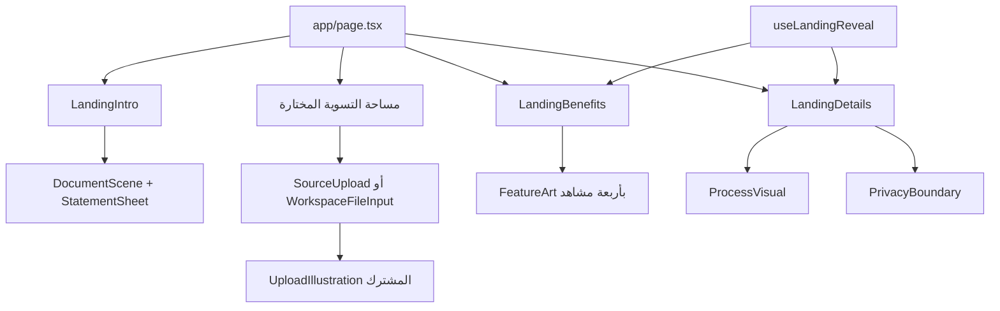

# كيف بنينا مشاهد تراصف والعمق والحركة

مرجع هندسي بتاريخ 13 أكتوبر 2026 للتنفيذ الموجود في **0.4.48**، بأساس التطبيق [`f9fca18`](https://github.com/mjodshamrani-ux/accounting/commit/f9fca18b5bafbb07f0671e1d1862472052a5bd02). يشرح أصول الرسوم وطريقة تركيبها وتحريكها ومواقع تعديلها، حتى يستمر تطويرها دون فقد الهوية أو إعادة أخطاء القص والتداخل. هذه إضافة توثيقية؛ لم يُعد تصميم المشاهد أو تشغيل فحوص المتصفح بهذه الدفعة.

يكمّل [دليل الهوية](DESIGN.ar.md) و[عقد الواجهة الموحدة](../WORKSPACE-IDENTITY.ar.md). الألوان والشعار والخط الأصلي وحقوقه في دليل الهوية؛ هنا تفاصيل صنع المشهد. القيم أدناه لقطة من الشفرة، وتحدّث مع أي تغيير فعلي بدل أن تصبح نسخة أخرى تخالف التنفيذ.

## الفكرة وطريقة التنفيذ

العمق البصري يأتي من ثلاثة أساليب مترابطة: **SVG بطبقات ذات أوجه وظلال وتدرجات، وتحويلات CSS للمنظور والتفاعل، وظهور تدريجي عند التمرير**. مشهد الأوراق والرفع والمميزات رسوم متجهية مرسومة بالكود؛ مجسم نافذة الخصوصية HTML/CSS بمنظور. تعديلها يجري في ملفات React وCSS نفسها، ولا يتطلب ملف Blender أو نموذج glTF أو مشروع Spline.

هذه المشاهد لا تستخدم محاكاة فيزياء أو مشهد WebGL. أسماء الطبقات مثل `back-layer` لا تعني وجود parallax متفاعل مع المؤشر. نسمّي القدرة الموجودة بدقة كي لا يبحث المطور عن مكتبة أو أصل غير موجود.

## خريطة الأجزاء ومصادرها

| ما يظهر للمستخدم                         | مصدر البناء                                                                                                                             | مصدر التنسيق أو الحركة                                                                                |
| ---------------------------------------- | --------------------------------------------------------------------------------------------------------------------------------------- | ----------------------------------------------------------------------------------------------------- |
| ورقتا المقدمة والمنصة المضيئة والمسح     | [DocumentScene وStatementSheet](../../components/document-scene.tsx)                                                                    | [document-scene.css](../../app/document-scene.css)                                                    |
| رفع الملفات الأصلي                       | [UploadIllustration وSourceUpload](../../components/source-upload.tsx)                                                                  | مجموعة `.source-card*` في [globals.css](../../app/globals.css)                                        |
| الرسم نفسه في بقية التسويات              | [WorkspaceFileInput وWorkspaceSources](../../components/workspace-chrome.tsx)                                                           | [workspace-chrome.css](../../components/workspace-chrome.css)، مع إعادة استخدام `.source-card__paper` |
| رسوم الخصوصية والأدلة والخطوات والمساعد  | [FeatureArt](../../components/feature-art.tsx)                                                                                          | مجموعة `.tarasuf-feature-*` في [landing-details.css](../../app/landing-details.css)                   |
| خطوات العمل المصغرة ونافذة حدود الخصوصية | `ProcessVisual` و`PrivacyBoundary` في [landing.tsx](../../components/landing.tsx)                                                       | `.tarasuf-process-*` و`.tarasuf-privacy-*` في `landing-details.css`                                   |
| الظهور مع التمرير                        | `useLandingReveal` في [landing.tsx](../../components/landing.tsx)                                                                       | `[data-reveal].tarasuf-reveal-pending`                                                                |
| الشعار والعناوين الحية                   | [BrandMark وBrandWordmark وDisplayHeading](../../components/brand.tsx)، [brand.ts](../../lib/brand.ts)                                  | الخطوط والمتغيرات في `globals.css`؛ التفاصيل في [DESIGN](DESIGN.ar.md)                                |
| النص العربي والإنجليزي                   | [locales/ar.ts](../../lib/i18n/locales/ar.ts) و[locales/en.ts](../../lib/i18n/locales/en.ts)، عبر [context](../../lib/i18n/context.tsx) | اتجاه النص والخصائص المنطقية، دون عكس هندسة الشعار                                                    |
| صور المشاركة والأيقونات الثابتة          | [public/brand](../../public/brand) و[مولد الأصول](../../scripts/generate-social-assets.mjs)                                             | توليد منفصل موضح أدناه                                                                                |



تبقى المقدمة والمميزات والخطوات والخصوصية في [app/page.tsx](../../app/page.tsx) خارج مساحة الموردين الخاصة، حتى تستمر الصفحة عند تغيير نوع التسوية. لا تعِد تركيب المجال المحمل بملفات المستخدم لمجرد إعادة حركة الدخول. [main.tsx](../../main.tsx) يثبت اللغة والاتجاه قبل الرسم الأول ويحمّل الأنماط العامة.

## مشهد الورقتين والمنصة

### الإحداثيات والنسب

| الجزء              | القيمة الحالية                               | الغرض                               |
| ------------------ | -------------------------------------------- | ----------------------------------- |
| مساحة SVG          | `viewBox="0 0 560 490"`                      | جميع الطبقات ضمن نظام إحداثيات واحد |
| حاوية المشهد       | `aspect-ratio: 560 / 490`، عرض أقصى `520px`  | تكبير متناسب دون ضغط الورق          |
| العرض الصغير       | أقصى `380px` عند عرض شاشة ≤`750px`           | تقليل المشهد كله مع حفظ النسبة      |
| الورقة             | `196 × 277.2`، حافة مستديرة `rx=9`           | نسبة A4؛ تعادل `210 / 297`          |
| موضع الأولى        | `translate(78 27) rotate(-5 98 277.2)`       | ميل خفيف حول أسفل الورقة            |
| موضع الثانية       | `translate(286 27) rotate(5 98 277.2)`       | توازن مقابل دون تشويه محاور الورقة  |
| حافة السمك         | نسخة خلفية عند `x=3 y=4` بنفس مقاس الورقة    | سمك فاتح مستقل عن ظل الورقة         |
| قص المحتوى         | مستطيل `x=1 y=1 width=194 height=275.2 rx=8` | إبقاء الحبر والمسح داخل الصفحة      |
| حافة المنصة العليا | تبدأ عند `y=335` في هندسة `portal-back`      | مرجع فحص الفجوة تحت الورق           |

المفتاحان الداخليان `supplier` و`ledger` تاريخيان ويحددان لون الورقة وطور حركتها. النص المرئي يأتي من `t.scene` ويصف السجلين عمومًا. لا تغيّر الاسم الداخلي أو ترتيب الرسم لتغيير رسالة المنتج، ولا تستنتج من المفتاح أن المشهد خاص بالموردين.

### ترتيب الطبقات الذي يصنع العمق

داخل SVG يرسم التنفيذ بهذا الترتيب: تعريفات الألوان والظلال، ثم هالة خلفية وظل أرضي، ثم `portal-back`، ثم `light-columns`، ثم الورقتان، ثم `portal-front`. ترسم ورقة `ledger` قبل `supplier`. ترتيب عناصر SVG هو جزء من تركيب الصورة. تبنى معرفات التدرجات والفلاتر والقص من بادئة `tarasuf-scene-` و`useId` لكل نسخة، فلا تشير ورقة إلى تعريف داخل رسم آخر.

المنصة تتكون من سطح قطع ناقص خارجي عند `(280,390)` بنصفي قطر `198 × 55`، وتجويف داخلي عند `(280,383)` بنصفي قطر `168 × 36`، وواجهة سميكة تصل إلى `y=463`. تتدرج الأوجه بين الكحلي والضوء الأزرق والبنفسجي. أعمدة ضوء شبه شفافة تصل من تحت الورق إلى التجويف؛ هي التي تربط الورقتين بالقاعدة بصريًا.

الورق يطفو **فوق** المنصة مع فجوة فعلية، ولا يعبر حافتها في الحركة الحالية. الإحساس بالخروج منها ناتج من الضوء والعمق. إذا أضيف مستقبلًا مرور حقيقي خلال الفتحة فذلك تغيير هندسي يحتاج حجبًا محسوبًا واختبارات جديدة؛ نقل الورقة إلى أسفل وحده يعيد عيب تداخل الحواف.

المحتوى والمسح يحملان `clipPath` داخل مجموعة الورقة نفسها وبإحداثياتها المحلية. يستعملان القص المحلي نفسه لكل ورقة، لا قناعًا عامًا على المشهد. يجب أن يتسع المحتوى أصلًا داخل الصفحة؛ القص آخر حاجز، وليس طريقة لإخفاء عنوان أطول من مساحته. آلية القص تحدد منطقة الرسم ولا تصغر الهندسة الأصلية تلقائيًا؛ لهذا تفحص الاختبارات الحدود أيضًا. [مرجع clipPath](https://developer.mozilla.org/en-US/docs/Web/SVG/Reference/Element/clipPath).

### حركة الورق والمسح

التحويل الثابت `translate/rotate` على مجموعة `.document-scene__sheet`، والطفو على الأب `.document-scene__float`. فصل التحويلين يمنع CSS المتحرك من إلغاء الميل الأصلي.

| الحركة                            | القيم الحالية                                                          |
| --------------------------------- | ---------------------------------------------------------------------- |
| الطفو `document-scene-rise`       | `9s`، من `translateY(0)` إلى `-9px` في منتصف الدورة ثم العودة          |
| منحنى الطفو والمسح                | `cubic-bezier(0.45, 0, 0.55, 1)`                                       |
| فرق طور الطفو                     | `supplier: -3s`؛ الثانية دون تأخير إضافي                               |
| المسح `document-scene-paper-scan` | `8.5s`، موضع Y من `80px` إلى `232px` ثم العودة                         |
| فرق طور المسح                     | `supplier: -1.8s` و`ledger: -5.9s`                                     |
| الشعاع                            | مستطيل عند `x=10 y=-25` بحجم `176 × 25`، وخطان رفيعان عند أسفله        |
| لون الشعاع                        | أزرق `#386FD4` للأولى، بنفسجي `#7951CB` للثانية، تدرج شفافية حتى `.12` |

كل شعاع يتحرك في إحداثيات ورقته ويخضع لقصها، لذلك لا يمر خط واحد فوق الفراغ بين الورقتين. فرق الأطوار يعطي تنفسًا هادئًا بدل حركة متطابقة آليًا. `transform-box: view-box` يثبت مرجع التحويل، و`will-change: auto` هو الوضع الحالي؛ لا يضاف ترويج دائم لكل طبقة بلا قياس موارد.

### متى تعمل الحركة

المعادلة الحالية داخل `DocumentScene`:

```text
running = inView && pageVisible && !paused && !reducedMotion
```

يراقب `IntersectionObserver` المشهد بإعداد `threshold: 0.12`، وتؤخذ `entry.isIntersecting` لحالة الظهور. يراقب أيضًا `document.hidden` وتغيير تفضيل تقليل الحركة. عند غياب المراقب يستخدم `inView=true`. تبدأ الأنيميشن متوقفة، ثم يشغلها `data-running="true"`؛ الإيقاف يحفظ الطور بواسطة `animation-play-state`.

زر ظاهر للإيقاف والاستئناف يحمل `aria-pressed` واسمًا مترجمًا ومساحة لمس لا تقل عن `44px`. عند تقليل الحركة يعطّل الزر وتزال الأنيميشن؛ تبقى قيمة المسح الثابتة `translateY(160px)`. المشهد الزخرفي مخفي عن قارئ الشاشة، ويبقى الوصف والزر متاحين.

**المسح لا يقرأ الملف ولا يمثل تقدم المحرك.** لا يربط نجاح أنيميشن بعلامة مطابقة أو اكتمال تحليل. بيانات الملفات وأرقامها لا تدخل إلى رسم المقدمة.

## رفع الملفات التفاعلي المشترك

### كيف رسمنا الورقة الصغيرة

`UploadIllustration` له `viewBox="0 0 180 126"`. الورقة الأمامية عند `(60,5)` والخلفية عند `(64,8)`، بمقاس `68 × 96.17` وحافة `rx=5`. السطح أبيض إلى `#F4F7FD`، والجدول والحافة من `currentColor`.

قاعدة عند `(90,106)` بنصفي قطر `54 × 12` ومسار جانبي يعطيها سمكًا، وظل أرضي عند `(90,117)` بنصفي قطر `54 × 5`. ظل الورقة `dy=3` و`stdDeviation=3` وعتامة `.1`. هذه الطبقات مع الميل تعطي الإحساس المجسم دون ملف صورة منخفض الدقة.

`useId` يولد بادئة خاصة لكل نسخة، ومنها معرفات التدرجات والفلاتر. لا تثبت ID واحدة في كل خانات الملفات؛ المجالات غير الظاهرة تبقى مركبة، ويمكن أن تتصادم التعريفات ولو بدت نسخة واحدة فقط. الرسم `aria-hidden` و`focusable=false`، وحاويته `pointer-events:none`.

### التفاعل والأنماط

- المصدر الأول: `--source-ink: #3373C9` و`--source-tint: #F4F8FF`؛ الثاني بنفسجي `#7944C7` و`#F8F5FF`.
- مركز الحركة `center bottom` و`transform-box: fill-box`. الورقة مستقرة عند ميل `-5deg` أو `+5deg` وارتفاع `translateY(2px)`.
- المرور المؤهل والتركيز والسحب ينقلانها إلى `rotate(0) translateY(-4px)` خلال `500ms cubic-bezier(0.22,1,0.36,1)`.
- نسخة الموردين تصغر الرسم من `180 × 126` إلى `146 × 102` عند ≤`750px`. النسخة المشتركة تضبط حاويتها في `workspace-chrome.css`؛ راجع computed styles قبل تعميم قياس أحد المسارين.
- تقليل الحركة يلغي التحويل والانتقال. بقاء `overflow:visible` لتنفس الظل لا يعفي من اختبار حدود الورقة نفسها.

### إعادة الاستخدام لا تعني تغيير حقل الملف

| المسار                       | ما يحدث فعليًا                                                                                                                                                                                            |
| ---------------------------- | --------------------------------------------------------------------------------------------------------------------------------------------------------------------------------------------------------- |
| `SourceUpload` الأصلي        | يستقبل `busy/ready/filename`، وحقل ملف داخل label، وعداد عمق للسحب. يتحقق من ملف واحد، ويسمح بإعادة اختيار الملف نفسه. عند وجود اسم ملف يستبدل الرسم بأيقونة ملف؛ هذه حالة إدخال وليست شهادة مطابقة       |
| `WorkspaceFileInput` المشترك | يعيد استخدام SVG نفسه، ويمرر خصائص input وأدواره وصيغه الأصلية. حقل `type=file` شفاف يغطي منطقة التحكم، والمحتوى الزخرفي لا يعترض المؤشر. يبقى الرسم ظاهرًا، وعرض اسم المصدر وحالته مسؤولية المجال المحيط |

في المسار المشترك يعيد `onDrop` حالة السحب البصرية فقط، ويترك اختيار الملف للحقل الأصلي؛ لا يصطنع `change` ولا يستدعي قارئًا موازيًا. فحص `:disabled` يشمل القفل الموروث من fieldset، وأنماط القفل تمنع حركة التفاعل. توحيد الواجهة يحافظ على `accept` و`onChange` والعنوان المتاح لكل دور.

`WorkspaceSources` يرتب العرض حسب `primaryIndices` ويفتح الأدلة الإضافية عند انتقال `primaryReady` إلى true. لا يعاد ترتيب مصفوفة المصادر المالية من أجل التنسيق، ولا يصبح دليل مطلوب اختياريًا لأنه داخل قسم مطوي.

## المميزات ذات العمق ورسوم خطوات العمل

`FeatureArt` يستخدم `viewBox="0 0 480 300"` وأربعة أنواع:

| النوع       | طريقة التعبير البصري                                    |
| ----------- | ------------------------------------------------------- |
| `privacy`   | مستندات خلف صندوق ذي أوجه ومنظور، ودرع وقفل             |
| `evidence`  | أوراق متراكبة وبطاقة دليل ورمز ارتباط                   |
| `workflow`  | ثلاث منصات متدرجة ومسار يصل الملفات بالمعالجة والمخرجات |
| `assistant` | فقاعتا سؤال وشرح ووسم دليل وقفل                         |

كل مشهد يبنى من paths وأوجه مضاءة وحواف أغمق وتحويلات `translate/rotate/matrix` للسطوح. مثال إسقاط ورق في مشهد workflow: `matrix(.8 .28 -.5 .35 …)`؛ ليس قانونًا عامًا يطبق على ورقتي المقدمة، اللتين تحفظان نسبة A4 دون تشويه.

التدرج الرئيسي هنا `#2D8CFF → #5962EE → #7C3AED`. الظل الكبير `dy=13 stdDeviation=12 opacity=.12`، والصغير `dy=5 stdDeviation=5 opacity=.10`، والأرضي تمويه بقيمة `9`. لكل نسخة معرفات محلية عبر `useId` و`paint(name)`.

شبكة المميزات 12 عمودًا: `7/5` ثم `5/7`، وتصبح `6/6` عند ≤`1000px` ثم عمودًا واحدًا عند ≤`720px`. الرسم يرتفع كاملًا `4px` عند hover بمؤشر دقيق، بانتقال `.55s cubic-bezier(.22,.65,.3,1)`. الطبقات المسماة `tarasuf-art-back-layer/front-layer` لا تتحرك مستقلة حاليًا. أي parallax لاحق توسعة جديدة وليست ميزة موجودة يجب «إصلاح تشغيلها».

البطاقة تقص تجاوز حدودها بينما SVG يسمح بامتداد الظل؛ تكبير الرسم يحتاج فحص الاثنين. ارتفاع الرسم الأساسي `240px` وللخصوصية `260px`، ثم `225px` على المحمول و`207px` عند ≤`380px`.

`ProcessVisual` يرسم ثلاث مراحل ثابتة: أوراق CSS مائلة `±4deg`، وصفوف حالة، وورقة عمل مصغرة. بطاقتا الملف هنا `86 × 111` كأيقونات مصغرة؛ لا نعمم نسبة A4 الدقيقة للمقدمة على كل مستطيل في الموقع. الرسوم لا تعرض بيانات عميل أو نتائج فعلية. على الشاشات المتوسطة تتغير شبكة الخطوة إلى نص ورسم جانبي، وعند ≤`480px` تعود عمودية. أسماء `supplier/ledger` داخل نصوص الخطوات تاريخية؛ النسخة الظاهرة تحكمها الترجمة العامة.

## مجسم حدود الخصوصية

`PrivacyBoundary` نافذة متصفح مصغرة مبنية من عناصر HTML. حاويتها `perspective:900px`، والجسم `rotateY(-12deg) rotateX(7deg)` مع `transform-style:preserve-3d`، والقاعدة تميل `rotateX(12deg)`. الحلقات في الخلف دوائر مائلة `rotateX(65deg)` تعطي منظورًا بيضاويًا.

سمك النافذة من ظلال متراكبة `2px 3px` و`5px 6px` وظل أرضي أوسع. وجه النافذة يقص محتواه؛ داخله ملفات وشعار أصلي على قاعدة فاتحة. `BrandMark` داخل القاعدة بحجم `40 × 57`، مع إزالة filter وtransform المحليين عنه للحفاظ على حدة الشعار. ترتيب شريط النافذة ثابت، واتجاه تسميته يوافق اللغة.

هذه التحويلات ثابتة وليست حركة دورانية مستمرة. الرسم مخفي عن قارئ الشاشة والمعنى في النص والشرح الرسمي المجاور. لا تضف أسهم رفع إلى سحابة أو عبارات خصوصية تناقض المعالجة المحلية أو تنزيل المستخدم لمخرجاته.

## السلاسة عند النزول في الصفحة

`useLandingReveal` يعمل على `[data-reveal]` داخل المميزات والتفاصيل، بواسطة `IntersectionObserver` بإعداد `threshold:0` و`rootMargin:"0px 0px -24px 0px"`. هذه مراقبة لدخول المنطقة المعروضة، دون استبدال تمرير المتصفح الطبيعي. [مرجع IntersectionObserver](https://developer.mozilla.org/en-US/docs/Web/API/Intersection_Observer_API).

1. ما هو ظاهر عند التهيئة يبقى ظاهرًا؛ لا يومض بالاختفاء ثم الرجوع.
2. يضاف `tarasuf-reveal-pending` إلى العناصر الواقعة خارج الشاشة فقط.
3. الحالة الأولى `opacity:0` و`translateY(20px) scale(.988)`، ثم `is-revealed` إلى عتامة 1 ودون تحويل، خلال `.65s`.
4. التأخير `.08s` للبطاقتين الثانية والرابعة والخطوة الثانية، و`.14s` للخطوة الثالثة. يظهر العنصر مرة واحدة ثم يلغي المراقب مراقبته.
5. التركيز بلوحة المفاتيح وروابط hash يكشفان العنصر وأسلافه اللازمة. عند غياب API يبقى المحتوى مقروءًا، وcleanup يزيل pending حتى لا يخفي المحتوى عند دورة React StrictMode التالية.

تغيير تفضيل تقليل الحركة يكشف جميع العناصر ويوقف المراقبة؛ CSS يلغي الانتقالات والتحويلات المعنية. يقرأ المشروع تفضيل النظام عبر `prefers-reduced-motion` في CSS و`matchMedia` حيث يلزم. [مرجع تقليل الحركة](https://developer.mozilla.org/en-US/docs/Web/CSS/Reference/At-rules/@media/prefers-reduced-motion).

توجد قواعد أقدم باسم `.reveal-ready` في `globals.css`، لكن الخطاف الحالي يستخدم `.tarasuf-reveal-pending`. اتبع صنف العنصر الفعلي وcomputed styles؛ لا تعدل قاعدة متشابهة الاسم ثم تفترض أنك غيرت الحركة المستخدمة. ولا تخفِ المحتوى افتراضيًا بانتظار JavaScript كي يصبح ظاهرًا.

التمرير العام في `globals.css` يستخدم `scroll-behavior:smooth` و`scroll-padding-top:106px`، وتتغير إزاحة التمرير إلى `85px` في قاعدة الشاشة الصغيرة. يتغير التمرير إلى `auto` عند وجود `.app-shell.in-session` أو `.visual-reader[open]`؛ هذا استثناء مقصود حتى لا يتعارض التمرير المؤجل مع التركيز والقوائم أثناء العمل. كما توجد قاعدة عامة لتقليل الحركة تفرض `animation:none` و`transition:none` و`scroll-behavior:auto` باستخدام `!important`، بجانب قواعد المكونات. لا تزل الاستثناء لتجعل كل انتقال «أنعم» فتفسد الاستخدام.

## المصدر البصري وما نعيد استخدامه

| المصدر                                                               | دوره وحدود استخدامه                                                                                                                                                         |
| -------------------------------------------------------------------- | --------------------------------------------------------------------------------------------------------------------------------------------------------------------------- |
| لوحة هوية تراصف التي قدمها صاحب المشروع                              | أصل الاتجاه: أبيض أساسي، كحلي، أزرق/بنفسجي، شريطان للشعار. الصيغة التنفيذية المحفوظة والألوان والهندسة في [DESIGN](DESIGN.ar.md)                                            |
| [Rzgfolio](https://rzgfolio.framer.ai/)                              | مرجع قدمه صاحب المشروع للراحة والسلاسة والظهور مع التمرير؛ لا نعتمد عليه لاستضافة مشاهد تراصف                                                                               |
| [Mihakk](https://mihakk.co/?lang=ar)                                 | مرجع قدمه لفكرة رفع مستند وتقديم تحليل ومشهد مسح؛ أصول تراصف القابلة للتعديل هي شفرتها أعلاه                                                                                |
| [خط ثمانية ومصدر تعبئته](../../public/fonts/Thmanyah-PROVENANCE.txt) | الخط الرسمي وأصل WOFF2 ومقارنته بالأصل موثقة؛ تصريح الاستضافة الخاص بالمشروع قائم بحسب إقرار صاحبه                                                                          |
| `lucide-react`                                                       | أيقونات الواجهة الصغيرة المستوردة في المكونات، لا مصدر الشعار أو الرسوم الكبيرة؛ النسخة مثبتة في [package.json](../../package.json) و[pnpm-lock.yaml](../../pnpm-lock.yaml) |
| ملفات React وCSS وSVG في المستودع                                    | المصدر العملي للمنظور والظلال والمسارات والحركة؛ لا يستبدل بلقطة شاشة أو صورة مستخرجة من موقع آخر                                                                           |

مراجع الاتجاه لا تمنح إذنًا بنسخ أصول المواقع أو الادعاء بأننا نستخدم محركها. رُوجعت المراجع التقنية المرتبطة أعلاه في تاريخ هذه الوثيقة؛ الإحالة إلى المواقع البصرية تسجل توجيه صاحب المشروع التاريخي ولا تثبت حالتها الحالية أو ملكية أصولها. تعذر جلب Mihakk في هذه المراجعة، لذلك لم نستنتج من الزيارة أي تفاصيل تنفيذية جديدة.

المصدر الرسمي للشعار الكامل هو `BrandMark` و[tarasuf-mark.svg](../../public/brand/tarasuf-mark.svg). الشريطان الصغيران داخل رسم الورقة زخرفة بمسارات خاصة؛ لا تستخرجهما لتعريف شعار بديل. لا ينعكس الشعار مع RTL، وتبقى العناوين نصًا حيًا بالخط المحلي وفق دليل الهوية.

### صور المشاركة والأيقونات

[generate-social-assets.mjs](../../scripts/generate-social-assets.mjs) يولد بطاقة `1200 × 630` وأيقونة Apple `180 × 180` وفافيكون `32 × 32` عبر Chromium، من SVG الشعار وخط Noto محلي، مع منع طلبات الشبكة أثناء الرسم. يستخدم **حاليًا** سلسلة خطوط عرض نظامية تبدأ بـGeeza Pro لاسم البطاقة؛ لا يدّعي استعمال ثمانية فيها كما يستعمله الموقع الحي. لذلك لا تفترض أن تشغيله على جهاز آخر يعيد PNG مطابقة بايتًا أو شكلًا دون فحص الخط الفعلي.

البناء المعتاد يستعمل [الأصول المحفوظة](../../public/brand) ومرجعها في [index.html](../../index.html). لا تشغّل مولد الصور ضمن كل build، ولا تغيّر بصمات الصور في مهمة توثيق. توحيد خط بطاقة المشاركة مع العنوان الحي، إن اختير لاحقًا، تغيير منفصل يحتاج مراجعة صور وحدود النص والخط وتحديث أصول مقصودًا.

## تاريخ التنفيذ الذي يرجع إليه المطور

| الالتزام                                                                                                   | ما يفيد الرجوع إليه                                             |
| ---------------------------------------------------------------------------------------------------------- | --------------------------------------------------------------- |
| [`72d7a7f`](https://github.com/mjodshamrani-ux/accounting/commit/72d7a7ff5f788b7dea739bb044504e5ce82686d0) | المشهد المتجهي والمنصة والخصوصية ورسم الرفع في 0.4.2            |
| [`24ef55b`](https://github.com/mjodshamrani-ux/accounting/commit/24ef55b2fd7af74396ca50d8333e0566fcf602a8) | صقل A4 والمسح وFeatureArt في 0.4.3                              |
| [`47e0562`](https://github.com/mjodshamrani-ux/accounting/commit/47e0562)                                  | ربط الواجهة والنصوص باللغة الإنجليزية بجانب العربية             |
| [`dd29782`](https://github.com/mjodshamrani-ux/accounting/commit/dd29782)                                  | استعادة الخط الأصلي وتوحيد مساحات العمل في 0.4.47               |
| [`f9fca18`](https://github.com/mjodshamrani-ux/accounting/commit/f9fca18b5bafbb07f0671e1d1862472052a5bd02) | مشاركة رسم الرفع الأصلي واستمرار الصفحة لجميع الأنواع في 0.4.48 |

الشفرة الحالية هي أساس التعديل، والالتزامات تبين سبب الوصول إليها. بعض تقارير التدقيق القديمة تظهر في تاريخ Git ولا توجد في الشجرة الحالية؛ لا تبن مسار العمل على ملف تاريخي محذوف أو مسار جهاز خاص.

## كيف نطور المشاهد دون إرجاع العيوب

1. حدد الجزء والسبب المرئي: قص، تداخل، نص، إيقاع، أو تفاعل. افتح مصدره من الجدول بدل إعادة صنع المشهد كله. راجع [DEV-28 إلى DEV-32](DEVELOPMENT-LESSONS.ar.md) عن فقد الهوية وتعقيد الواجهة والبناء.
2. ثبّت النسب والحدود قبل تعديل الظلال. في الورق افصل الحركة على الأب عن موضع وميل الابن، واحتفظ بالقص داخل نظام الإحداثيات نفسه. عند تغيير الأبعاد حدّث المحتوى والشعاع والفجوة والاختبار معًا.
3. اعمل على متغير واحد مفهوم في كل تجربة: سعة الطفو أو مدته أو وضوح الحافة مثلًا. لا تضف اهتزازًا وparallax وتمويهًا أثقل معًا ثم تعجز عن تحديد سبب البطء.
4. اختبر اللغة الطويلة والتشكيل والحقول وحالة التعطيل أولًا. لا تضع طبقة التقاط pointer فوق input ولا تجعل الرسم بديلاً عن اسم المصدر وحالته النصية.
5. افحص اللقطة الثابتة ودورة الحركة والتفاعل. لقطة جميلة واحدة لا تكشف تصادمًا في منتصف الدورة، والاختبار الهندسي لا يحكم وحده على راحة الظلال والإيقاع.
6. حافظ على إيقاف الحركة وخيار النظام والظهور عند التركيز وhash. لا تربط زخرفة ببيانات مالية، ولا تجعل animation شرطًا لاستخدام الموقع.
7. قس أثر التغيير على الأجهزة المتاحة؛ الظلال والفلاتر قد ترفع كلفة الرسم. لا تعد بـ60fps أو تحسن على هاتف ضعيف من شكل viewport وحده. يبرر أي استخدام لاحق لـWebGL حاجة واضحة وميزانية وحالة بديلة.
8. حدّث المرجع واللقطات الخاصة ونتائج الفحص، وراجع ملفات المصدر والبصمات المطلوبة وفق [التسليم](DELIVERY.ar.md). لا تنشر لقطة فيها ملف عميل أو معلومات جلسة.

تحسينات ممكنة لاحقًا: ضبط الظلال على هاتف فعلي ضعيف، تعميق تفاعل طبقات المميزات مع بديل ثابت، وفحص إسقاط الملفات من نظام التشغيل على متصفحات إضافية. هذه فرص اختيارية، وليست قدرات منفذة بهذه الوثيقة أو تغييرًا لترتيب خطة المحرك.

## الفحوص القائمة ومعيار قبول التغيير

| الفحص                                                                                                                                    | ما يغطيه فعليًا                                                                                                                                                                                           |
| ---------------------------------------------------------------------------------------------------------------------------------------- | --------------------------------------------------------------------------------------------------------------------------------------------------------------------------------------------------------- |
| `verifySceneGeometry` في [brand-browser-cases](../../scripts/brand-browser-cases.mjs)                                                    | نسبة A4، قص محلي صالح، احتواء المحتوى والشعاع، عدم التشوه وعدم ملامسة الحافة، عبر 17 عينة موزعة على دورة الحركة عند عروض `320/390/768/820/1024/1280`                                                      |
| بقية فحوص brand-browser                                                                                                                  | الخط الفعلي والبصمة، الإيقاف وخارج الشاشة وتقليل الحركة، الروابط والتركيز، تفاعل الرفع الأصلي والسحب المتداخل ورفض عدة ملفات دون مسح السابق                                                               |
| [unified-workspace-browser](../../scripts/unified-workspace-browser.mjs)                                                                 | تطابق هندسة رسم الرفع الأصلي مع الخانات المشتركة، معرفات ومراجع ألوان محلية، input حقيقي، تغير حالة التركيز والسحب، المجالات الاثنا عشر واستمرار الصفحة وحفظ العمل                                        |
| [reconciliation-entry](../../scripts/reconciliation-entry-browser.mjs) و[domain-navigation](../../scripts/domain-navigation-browser.mjs) | الدخول والتنقل والمعالم والأدوار والواجهة المشتركة                                                                                                                                                        |
| [visual-identity](../../scripts/visual-identity-browser.mjs)                                                                             | مقارنة بناءين بكسلًا بكسلًا: الصفحة كاملة قبل اختيار النوع وبعد مثال كل مساحة وأقسامها مفتوحة، AR/EN و390/1440، لتغيير لا يُقصد به تغيير ما يُرسم؛ فحصها الذاتي في CI يرى تغييرًا مزروعًا ويعود إلى الصفر |

فاحص الهندسة المشترك لا يغطي بمفرده كل مرجع filter/clip أو جودة جميع الظلال. أحداث drag الاصطناعية ليست إثبات إسقاط من نظام التشغيل في جميع المتصفحات. والقفز عبر 17 عينة لكل أنيميشن ليس برهانًا لكل تركيب زمني ممكن لدورتين مختلفتين؛ يبقى فحص الحركة الفعلية مهمًا عند تغيير الأطوار والمدد.

في تغيير بصري فعلي، اختر الفحوص المتأثرة ثم نفذ البوابات المطلوبة. من مداخل المشروع القائمة:

```sh
pnpm build
pnpm test:browser
pnpm test:browser:unified-workspace
pnpm test:browser:reconciliation-entry
pnpm test:browser:domain-navigation
```

`brand-browser-cases.mjs` وحدة يستدعيها `browser-test.mjs`؛ تشغيلها منفردة كملف Node ليس إثبات مرور الفحوص. فحوص المتصفح تعتمد توزيعًا مبنيًا ومتصفحًا مثبتًا وفق [دليل التسليم](DELIVERY.ar.md). عند المراجعة البصرية خذ AR/EN، وشاشة واسعة ومحمولًا، والحركة العادية والمخففة، وتحقق من التركيز والرفع والتعطيل والعودة إلى العمل القائم. دوّن ما شغّل فعلًا وما لم يُختبر، ولا تنسب نجاح تشغيل قديم إلى تغيير جديد.
