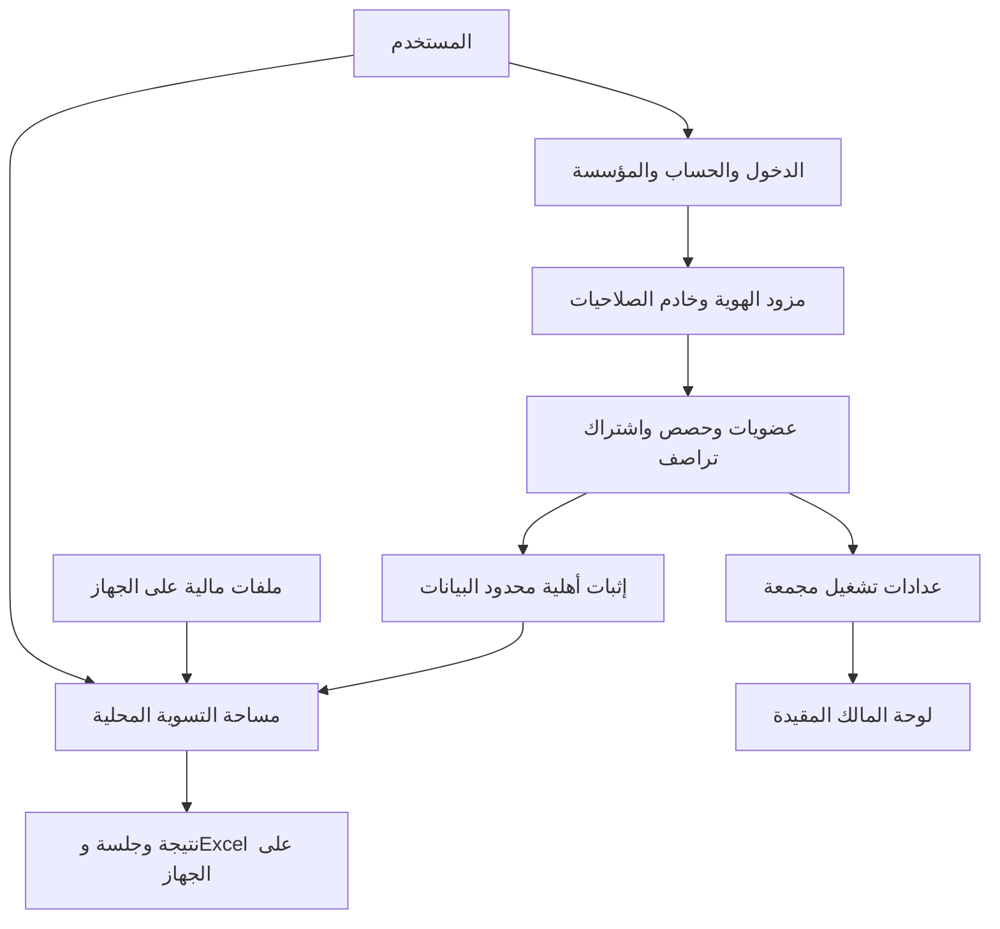

# خطة الحسابات ولوحة المالك والتوسع التجاري

**الحالة: خطة توسعية غير منفذة.** أُضيفت بطلب صاحب المشروع في 13 أكتوبر 2026 فوق أساس التطبيق 0.4.48. لا تضيف هذه الوثيقة تسجيل دخول أو تتبعًا أو خدمة خارجية إلى التطبيق الحالي، ولا تغير أولوية صقل المحركات في [خطة التنفيذ](../CURRENT-PLAN.ar.md).

## الهدف والقرار الأساسي

تمكين مالك تراصف من معرفة استخدام المنتج ونموه، وتمكين الأفراد والشركات من امتلاك حسابات وصلاحيات واشتراكات وتجارب مجانية، مع بقاء ملفات التسويات ومحتواها ونتائجها على جهاز المستخدم. نحصل على أقل قدر لازم لإدارة الخدمة، ولا ننشئ قاعدة بيانات مالية عن العملاء.

الحساب يحتاج بعض البيانات خارج الجهاز، مثل معرف الحساب ووسيلة الدخول وحالة الاشتراك. لذلك تكون العبارة الصادقة عند تنفيذ الخطة: **نعالج ملفاتك المالية محليًا، ونستخدم بيانات حساب محدودة لتشغيل الخدمة وحمايتها**. لا يجوز حينها القول إن الموقع لا يجمع أي بيانات إطلاقًا، أو أن العدادات المرتبطة بحساب مجهولة الهوية تمامًا.

الموافقة هنا على إدراج الرؤية والخطة. تشغيل القياس والحسابات مستقبلًا يحتاج تنفيذ عقدها واختبارات الخصوصية والأمان وتحديث بيان الخصوصية قبل التفعيل؛ لا تفسر الخطة كإذن بإدخال SDK أو إرسال أحداث من النسخة الحالية.

## مبادئ لا تتغير مع البيع

- جودة المطابقة وأسبابها لا تختلف حسب الخطة المدفوعة. الاشتراك يحدد خدمات ومزايا واضحة، ولا يمنح نتيجة ضعيفة صفة «معتمدة».
- لا يطلع مالك المنصة أو مدير الشركة على ملفات التسويات من خلال لوحة الحسابات. تسجيل العضوية لا ينشئ مشاركة مالية تلقائية.
- لكل شخص حساب مستقل. للشركة مساحة وعضويات ومقاعد، وليس كلمة مرور مشتركة لجميع الموظفين. رمز الدعوة أحادي الاستخدام ومؤقت، ولا يعمل ككلمة مرور دائمة.
- لا نرسل أسماء الملفات أو محتواها أو مبالغها أو أرصدتها أو أسماء الموردين أو الحسابات البنكية أو أسئلة المساعد أو بصمات ملفات التسوية لأجل العد أو الاشتراك.
- لا يعطل انتهاء التجربة تصدير عمل أُنجز بالفعل، ولا يخفي الفروق أو يحذف أدلة محلية. تعذر خدمة الاشتراك لا يتحول إلى خطأ محاسبي.
- لا بصمة جهاز للتسويق أو لتجميع هوية خفية، ولا تسجيل شاشة أو نقرات تفصيلي أو استدعاء إعلانات. لا تضاف مزامنة سحابية للملفات ضمن هذه الخطة.
- لا وعد بأمان مطلق. نحول المخاطر إلى اختبارات وحدود تشغيل واضحة، ونحافظ على حواجز المصدر والنشر الحالية.

## الاستضافة والحدود التقنية

### GitHub يبقى مرجع الشفرة وليس خادم الحسابات

النسخة الحالية تطبيق ثابت على GitHub Pages. لا يمكن حماية حسابات أو عدادات أو أسرار بمجرد إخفاء زر في JavaScript. توضح سياسة GitHub أن Pages ليست لاستضافة SaaS تجارية أو معاملات حساسة مثل إرسال كلمات المرور. لذلك **تسبق استضافة إنتاج مناسبة تفعيل الحسابات التجارية والبيع**، مع بقاء المستودع والخطط والاختبارات على GitHub. لا يكفي إضافة نطاق مخصص فوق Pages لتغيير هذه الحدود. [سياسة GitHub Pages](https://docs.github.com/en/pages/getting-started-with-github-pages/github-pages-limits)

لا نشتري استضافة ولا نختار مزود هوية بهذه الدفعة. في `ACC-0` نقارن خيارات فعلية بحسب مكان البيانات، مدة سجلات المزود، التحكم بالأمان، الحذف والتصدير، توافر الخدمة، الكلفة، وسهولة الانتقال. لا يجعل وجود مزود مُدار المنتج آمنًا تلقائيًا.

### ثلاث مناطق منفصلة

لا يوجد في التصميم مسار لنقل الملف أو النتيجة من `W` إلى لوحة المالك. طلب أهلية التشغيل، إن اختير ضمن التجربة، يحمل معرف طلب عشوائيًا فقط وحقولًا محددة بالعقد. لا ترفق به بصمة الملف أو نتيجة التسوية لإثبات الاستخدام.

| المنطقة             | ما تحتويه                                                         | ما لا يحق لها استلامه                              |
| ------------------- | ----------------------------------------------------------------- | -------------------------------------------------- |
| مساحة العمل         | قراءة الملفات والمحرك والمساعد المحلي والمراجعة والتصدير          | SDK هوية/قياس قادر على قراءة المستند أو DOM المالي |
| إدارة الخدمة        | الحسابات والعضويات والجلسات والتراخيص والحصص وفواتير اشتراك تراصف | مستندات العميل أو محتواها أو نتائجها أو محادثاتها  |
| القياس ولوحة المالك | إحصاءات تشغيل مجمعة وتقارير الاشتراك وحالة الخدمات                | بيانات مالية للعملاء أو مراقبة تفصيلية لعمل الموظف |

الاتجاه المعماري المقترح فصل مساحة العمل عن صفحات الحسابات بأصل ويب مستقل، وخادم جلسات للمنطقة المتصلة، ورسائل بين المناطق ذات مخطط صغير ومغلق. يثبت `ACC-0` قابلية هذا الفصل مع PDF والعمال والتصدير وAI المحلي والمقاسات المختلفة قبل اعتماده؛ الفصل بمجرد ملفات أو React components غير كافٍ.

إذا استُخدمت رسائل بين الأصول، تتحقق من `origin` و`source` ونوع الرسالة ومعرف طلبها وحجمها، ولا تستخدم `*` للجهة المستقبلة. لا تمر رموز جلسة الحساب إلى محرك الملفات. تضبط سياسات CSP والموارد لكل منطقة، وتختبر كل مخارج الشبكة، لا `fetch` وحده. وجود أصلين أو CSP لا يثبت عدم التسرب أمام اختراق سلسلة النشر؛ لذلك تبقى مراجعة الاعتمادات والإصدارات جزءًا من العقد.

## الحسابات وتسجيل الدخول والخروج

### مسار بسيط للمستخدم

تصفح المنتج والشرح والعينة الاصطناعية لا يحتاج حسابًا. عند بدء تجربة الحساب: وسيلة دخول واحدة واضحة، اسم عرض اختياري، ثم المساحة. لا يطلب رقم هوية أو رقم هاتف أو بيانات شركة قبل الحاجة إليها. العضوية المؤسسية تأتي بدعوة أو إنشاء مؤسسة معتمد، لا بمجرد امتلاك بريد ينتهي بنطاق معين.

الاتجاه المفضل **مفاتيح المرور Passkeys** مع مسار استرداد مختبر. يحدد نطاق الدخول المستقر قبل إصدار المفاتيح كي لا نربط الحسابات بنطاق تجريبي ثم نصعّب الانتقال. لا يستقبل تراصف بصمة الإصبع أو الوجه من WebAuthn؛ التحقق الحيوي يبقى لدى أداة المصادقة. لا يعني ذلك أن بيانات الحساب نفسها مجهولة. [W3C WebAuthn](https://www.w3.org/TR/webauthn-3/#sctn-privacy-considerations)

إذا احتاجت الشريحة بريدًا وكلمة مرور، ينفذها مزود هوية مناسب أو مكوّن مُراجع، مع كلمات طويلة ومدير كلمات مرور ومنع الكلمات الشائعة أو المكشوفة ورسائل لا تكشف وجود الحساب. تفرض حماية إضافية قوية على حساب مالك المنصة ومديري المؤسسات، وإعادة تحقق عند تغيير البريد أو الصلاحيات أو وسيلة الدخول. لا يكون استرداد الحساب مسارًا أضعف يستطيع تجاوز تلك الحماية. [OWASP Authentication](https://cheatsheetseries.owasp.org/cheatsheets/Authentication_Cheat_Sheet.html)

لا نخزن كلمة المرور كنص أو بتشفير قابل للعكس. إذا استضيف تخزينها لدينا، يطبق تجزؤ مخصص مثل Argon2id بملح مستقل ومعاملات مراجعة وقت التنفيذ، وتبقى الأسرار خارج المستودع والمتصفح. ليس SHA-256 وحده بديلًا. [OWASP Password Storage](https://cheatsheetseries.owasp.org/cheatsheets/Password_Storage_Cheat_Sheet.html)

عند ربط مزود عبر OAuth/OIDC يكون الاتجاه Authorization Code مع PKCE من نوع S256، وعناوين عودة مسجلة بدقة، وربط `state` و`nonce` بالتدفق حسب البروتوكول، والتحقق الخادمي من جهة إصدار الرموز وجمهورها وصلاحيتها. لا تستخدم تدفقًا يعيد access token في الرابط ولا تطبيقًا يدويًا غير مراجع للبروتوكول. تغطي اختبارات الدخول حقن الكود وإعادة استخدامه والعودة إلى نطاق أجنبي. [IETF RFC 9700](https://www.rfc-editor.org/rfc/rfc9700.html)

### دورة حياة الجلسة

جلسات الحساب تديرها جهة الخادم، بكوكيز `Secure` و`HttpOnly` ونطاق ضيق وسياسة `SameSite` ملائمة لتدفق الدخول، مع حماية CSRF وتحقق المصدر. لا تحفظ رموز طويلة العمر في `localStorage` أو الروابط. تعتمد مهلة خمول ومدة قصوى وتدويرًا وإبطالًا فعليًا؛ قيمها تثبت قبل التجربة بناء على المخاطر وسير عمل المحاسب. `HttpOnly` لا يمنع وحده أن ينفذ XSS أفعالًا باسم المستخدم. [OWASP Session Management](https://cheatsheetseries.owasp.org/cheatsheets/Session_Management_Cheat_Sheet.html)

المطلوب في الواجهة: خروج من هذا الجهاز، خروج من كل الجلسات، وعرض جلسات الحساب النشطة بصورة محدودة دون تحويلها إلى مراقبة أداء. تظهر معالجة واضحة لفقد الجهاز أو وسيلة الدخول، مع إشعار المستخدم بالتغيير وإبطال الجلسات المتأثرة.

**جلسة الحساب تختلف عن جلسة التسوية.** انتهاء الدخول أثناء عمل محلي يقفل العمليات المتصلة الحساسة، ولا يحذف المصدر أو يغير نتيجة المحرك. الخروج الصريح أو تبديل المستخدم يوقف العمال ويمسح العرض والذاكرة المؤقتة المالية الخاصة بالمساحة بعد إتاحة الحفظ المحلي المناسب؛ لا يرى المستخدم التالي عمل السابق. لا نستطيع إلغاء ملفات نزّلها المستخدم إلى جهازه، ولا نزعم محوًا مضمونًا لكل أثر من ذاكرة الجهاز.

إذا كان هناك عمل غير محفوظ، يوضح أثر الخروج قبل تنفيذه. بعد إكمال الخروج لا تبقى نتائج مالية ظاهرة في التبويبات الأخرى. تختبر العودة بالزر الخلفي وتعدد التبويبات واستعادة المتصفح وتغيير المؤسسة، ولا يكفي إخفاء زر الحساب.

## الشركات والصلاحيات

| الدور             | الصلاحيات المستهدفة                                       | الحدود                                            |
| ----------------- | --------------------------------------------------------- | ------------------------------------------------- |
| مالك المنصة       | إحصاءات كلية، خطط وأسعار، إدارة حالة حساب عند ضرورة الدعم | لا ملفات أو نتائج عملاء، ولا انتحال جلسة محاسب    |
| مسؤول أمني للمنصة | تحقيقات دخول وصلاحيات وسجلات أمن محدودة                   | وصول استثنائي موثق ومحدود المدة والغرض            |
| مالك المؤسسة      | دعوات ومقاعد وأدوار وخطة المؤسسة                          | لا ملفات الموظفين المحلية تلقائيًا                |
| مسؤول الفوترة     | اشتراك تراصف وفواتيره ومقاعده حسب التفويض                 | لا صلاحيات مالية على التسويات أو إدارة أمنية عامة |
| عضو               | استخدام المزايا المتاحة وبيانات حسابه                     | لا تغيير أدوار أو قراءة مؤسسة أخرى                |
| مراجع عمل مالي    | دور توسعي مستقبلي ضمن مشاركة صريحة مستقلة                 | لا يتفعّل من عضوية المؤسسة وحدها                  |

يمكن للشخص أن ينتمي إلى أكثر من مؤسسة، لكن السياق الحالي واضح ويتحقق منه الخادم في كل طلب. لا يثق الخادم في `tenant_id` القادم من العميل، ولا تعد عشوائية المعرفات أو إخفاء الواجهة تفويضًا. تضبط العضوية على الطلب وقاعدة البيانات والمهام المؤجلة والمخبأ والتصدير الإداري. [OWASP Multi-Tenant Security](https://cheatsheetseries.owasp.org/cheatsheets/Multi_Tenant_Security_Cheat_Sheet.html)

صلاحية إدارة المؤسسة لا تورث صلاحية إدارة المنصة. ترفض واجهات لوحة المالك الطلب غير المفوض على الخادم، حتى لو عرف المستخدم رابطها. لا تحمل حزمة JavaScript العامة مفاتيح إدارة أو وصولًا مميزًا لقاعدة البيانات؛ لكل إجراء إداري مؤثر أثر مراجعة، وللدعم صلاحيات ضيقة بدل حساب شامل مشترك.

إزالة عضو أو خفض دوره تمنع طلباته المتصلة اللاحقة، بما فيها الجلسات القديمة. دعوة منتهية أو مستعملة لا تعيد العضوية. تمنع إزالة آخر مالك بلا انتقال موثق. يتطلب نقل ملكية المؤسسة تحققًا قويًا وسجلًا واضحًا. الموظف المغادر قد يحتفظ بتنزيلات سابقة؛ إدارة الهوية ليست نظام محو عن بعد لأجهزة الأفراد.

## لوحة المالك وما يمكن معرفته بصدق

اللوحة الأولى صغيرة: نمو الحسابات، نشاط الخدمة المتصلة، التجارب والاشتراكات، ثم السلامة التشغيلية. لا نعرض «الآن متصل» أو «نجاح التسويات» إذا لم يوجد تعريف ودليل صالح لهما.

| الرقم               | تعريفه ومصدره المقترح                            | القيد الذي يظهر معه                                        |
| ------------------- | ------------------------------------------------ | ---------------------------------------------------------- |
| حسابات جديدة        | حسابات فُعّلت خلال الفترة، من خدمة الهوية        | منفصلة عن الطلبات الفاشلة والحسابات المحذوفة والتجريبية    |
| حسابات نشطة         | حساب مميز نفذ فعلًا متصلًا معرفًا خلال يوم/أسبوع | ليس عدد أشخاص مؤكدًا ولا إجمالي استخدام المحرك دون اتصال   |
| مرات الدخول         | عمليات مصادقة ناجحة، مع فصل إعادة المحاولة       | ليست زيارات ولا زمن حضور                                   |
| مرات الخروج         | خروج صريح تم إبطاله على الخادم                   | إغلاق التبويب أو قطع الشبكة ليس خروجًا مرصودًا موثوقًا     |
| جلسات منتهية        | جلسات انتهت مهلة صلاحيتها أو أُبطلت              | لا نجمعها مع الخروج الصريح ثم نسميها «غادر الموقع»         |
| استخدام التجربة     | وحدات أهلية محجوزة/مستهلكة/معادة وفق العقد       | طلب تشغيل لا يثبت نتيجة محاسبية صحيحة أو اكتمال تشغيل محلي |
| المؤسسات والمقاعد   | مؤسسات فعالة ومقاعد مستخدمة/متاحة                | مؤسسة واحدة لا تساوي مستخدمًا واحدًا                       |
| الاشتراكات والتحويل | اشتراكات مؤكدة لدى خدمة الفوترة ومقام تجربة معرف | لا يعتمد على صفحة نجاح الدفع، وتفصل الملغاة والمستردة      |
| إتاحة الخدمة        | صحة الهوية والصلاحيات والفوترة والقياس           | تعطل الاتصال ليس حكمًا على صحة المحرك                      |
| زيارات الصفحات      | عداد اختياري لصفحات عامة ضمن سياسة قياس مستقلة   | تقديري ومشروط بالتغطية؛ ليس عدد زوار فريدين بلا تتبع       |

تعرض كل بطاقة الفترة والمنطقة الزمنية وتعريف الرقم وحداثة البيانات ومصدره، وتفصل أرقام الاختبار عن الإنتاج. «المجهول» لا يعرض صفرًا. المقارنة بين فترتين تراعي تغير سياسة القياس أو الموافقات أو انقطاع النظام. لا نستنتج المهنة أو المؤسسة أو المكان من عنوان IP.

**لوحة استخدام المنتج ليست لوحة دقة المحرك.** لا يستنتج نجاح المطابقة أو صحة الأرصدة من حدث «طلب تشغيل» أو «تصدير». تبقى مقاييس الدقة والأعضاء والحقيقة المرجعية في [خطة الجودة](../reference/QUALITY.ar.md) من اختبارات مستقلة أو دراسات مأذون بها؛ لا نجمع ملفات العملاء لنملأ رسمًا بيانيًا.

### فصل ثلاث فئات من البيانات

1. **تشغيل الحساب والأمان:** بيانات لازمة للدخول والصلاحيات والحصة والحماية، محددة ومعلنة. لا نسميها اختيارية ثم نوقف الخدمة إذا رفض المستخدم استخدامها، ولا نخفي داخلها تحليلًا تسويقيًا.
2. **مؤشرات إدارية مجمعة:** تنتج من عدادات الخدمة الضرورية، بصلاحيات مقيدة ومن دون خط زمني تفصيلي لكل موظف. الوصول الاستثنائي إلى هوية حساب للدعم يكون في شاشة منفصلة ويسجل سببه.
3. **تحسين المنتج الاختياري:** مؤشرات عامة محدودة من صفحات أو أفعال مسموحة فقط بعد تفعيل واضح قابل للسحب؛ إيقافها لا يلغي الحساب ولا التجربة. لا يرسل المحرك في المرحلة الأولى نوع الملف أو حجم عمل الشركة أو نوع التسوية أو زمنها الدقيق.

رفض القياس الاختياري أو حظره يجعل تلك العينة ناقصة، فلا نعممها على جميع المستخدمين. لا نستخدم معرف البريد بعد تجزئته كهوية تحليلية مزعومة المجهولية. وحتى المعرف العشوائي المرتبط بالحساب بيانات قابلة للربط، له غرض ومدة وحماية.

## عقد البيانات والاحتفاظ

### الحد الأدنى المقترح

`Account` لمعرف عشوائي ومرجع مزود الهوية وحالة التفعيل؛ `Organization` و`Membership` للدور والحالة؛ `Entitlement` للمزايا؛ `TrialLedger` لحركات الحصة؛ `Subscription` لمرجع اشتراك تراصف؛ `SecurityEvent` لأحداث أمن محددة؛ و`DailyAggregate` لعدادات مجمعة. هذه نماذج مفاهيمية وليست جداول منفذة أو اختيار قاعدة بيانات نهائيًا.

لا تنشأ أعمدة مالية مثل مورد أو فاتورة أو مبلغ تسوية في هذه المنطقة. تحفظ فاتورة شراء اشتراك تراصف في نطاق الفوترة فقط؛ هي تختلف عن فواتير العميل التي يعالجها المحرك محليًا. لا تنسخ البريد إلى كل جدول وسجل، ويحدد من يملك الوصول إليه ولماذا.

| الفئة                    | سياسة مبدئية مقترحة قبل التنفيذ                                     | اختبار الإغلاق                                                |
| ------------------------ | ------------------------------------------------------------------- | ------------------------------------------------------------- |
| بيانات الحساب والعضوية   | مدة وجود الخدمة ثم حذف أو فصل ما لا يلزم بعد الإغلاق                | تصدير بيانات الحساب وحذفه دون التأثير في مؤسسة أخرى           |
| كلمات المرور/المفاتيح    | لدى نظام الهوية وفق عقده، ولا تظهر في التقارير أو الدعم             | لا أسرار في المتصفح أو logs أو Git أو قياس المنتج             |
| أحداث أمان الحساب        | 30 يومًا كنقطة بدء للمراجعة، مع استثناء حادث محدد موثق              | انتهاء آلي وصلاحية قراءة مقيدة واختبار منع العبث              |
| IP للحماية من الإساءة    | معالجة عابرة؛ إن لزم التخزين فهدف أولي أقصاه 24 ساعة في طبقة منفصلة | لا يدخل لوحة المنتج ولا يصبح بصمة تتبع                        |
| أحداث تحسين اختيارية خام | لا نجمعها في المرحلة الأولى؛ أي اقتراح لاحق له مدة قصيرة مبررة      | رفض الحقول غير المسموحة والحذف عند انتهاء الغرض               |
| مؤشرات يومية مجمعة       | هدف أولي 12 شهرًا، دون معرّفات فردية دائمة                          | منع استنتاج هوية مجموعة صغيرة أو استخراجها بفروق الاستعلامات  |
| حركات الحصة              | مدة التجربة وتسوية اعتراضاتها؛ تثبت مدة محدودة في ACC-0             | لا إعادة استهلاك عبر retry ولا احتفاظ غير محدود بحجة الاحتيال |
| فواتير اشتراك تراصف      | مدة يحددها الالتزام المعمول به في أسواق البيع                       | فصلها عن تحليلات المنتج وتوضيح ما يبقى بعد حذف الحساب         |
| النسخ الاحتياطية         | دورة مقترحة لا تتجاوز 35 يومًا للبيانات القابلة للحذف               | إعادة تطبيق سجل الحذف عند الاستعادة وعدم إحياء حساب محذوف     |

الأرقام أعلاه **مقترحات تصميم وليست متطلبات قانونية أو تعهدات مفعلة**. يغلق `ACC-0` مددًا فعلية لا تتجاوز ما يحتاجه الغرض، بما يشمل CDN والهوية والبريد وقاعدة البيانات والمراقبة ومزود الدفع. إن كان مزود يحتفظ أطول من السياسة فلا نعد المستخدم بسياسة لا نستطيع تنفيذها. تراجع متطلبات البلدان والإقامة ونقل البيانات والعقود قبل اختيار المزود أو البيع.

تجميع البيانات وحده لا يضمن إخفاء الهوية. نقترح منع تقسيم مؤشرات المنتج إلى مجموعات أقل من عشرة حسابات، ودمجها أو إخفاءها، مع حدود للأبعاد والاستعلامات المتداخلة؛ هذا حاجز مبدئي وليس إثبات anonymization. الأرقام الإدارية اللازمة لمؤسسة صغيرة تعامل كبيانات مقيدة، ولا تعرض علنًا تحت وصف «مجهولة».

السجلات لا تحمل كلمات مرور أو رموز جلسات أو ترويسات تفويض أو أجسام طلبات مالية. تستخدم أكواد أحداث وأسباب محددة بدل نص أخطاء حر قد يحتوي بيانات المستخدم، مع تنقية الإدخال ومنع حقن السجلات. هذه حدود تتفق مع فصل المعلومات الحساسة عن logging في OWASP. [OWASP Logging](https://cheatsheetseries.owasp.org/cheatsheets/Logging_Cheat_Sheet.html)

## التجربة المجانية والاشتراك

### تعريف التجربة قبل وضع العداد

العدد `N` ومدة التجربة وسعر المقعد لم تُحسم. القرار المقترح تجربة محدودة لحساب متحقق أو مؤسسة تجريبية، مع عينة اصطناعية مفتوحة لا تستهلك الحصة. يظهر المتاح بوضوح قبل الفعل الذي يحتسب. لا بطاقة دفع للتجربة الأولى ولا انتقال مدفوع صامت.

الأكثر اتساقًا مع الخصوصية البدء بمقاعد ومدة ومزايا خدمية واضحة. إذا اختير عدد تشغيلات، يسمى **عدد مرات الإذن بالتشغيل**، ولا يعد عدد تسويات صحيحة أنجزها المستخدم. يعرض التعريف في الواجهة ولا يتركه ضمن شروط طويلة.

قيمة عدد التجارب تمنع الهدر التجاري البسيط، لكنها لا تبرر تتبع الجهاز أو طلب ملفات مالية. يسمح بتحقق بريد وحدود طلبات ومعالجة إساءة محدودة الغرض. لا يمكن إثبات أن حسابين يعودان لشخص واحد دون معلومات إضافية؛ نختار مستوى إساءة مقبولًا ونقيسه قبل زيادة الاحتكاك.

### عقد استهلاك لا يظلم المستخدم

1. التصفح والعينة واختيار الملف واكتشاف فشل القراءة الأولي لا يستهلك وحدات. يتم التحقق المحلي قبل طلب أهلية جديد حيث يمكن ذلك.
2. عند الفعل المحدد، يتحقق الخادم من الحساب والمؤسسة والخطة، ويحجز وحدة داخل معاملة ذرية بمعرف طلب عشوائي و`idempotency key`. محاولة مكررة بنفس المفتاح لا تخصم مرة ثانية، ويقيد المفتاح بنطاق الحساب والمؤسسة والفعل.
3. تميّز الدفتر حالات `reserved / consumed / released / expired` بسياسة معلنة. تنفيذ المحلي لا يمكن إثبات اكتماله على الخادم من إقرار العميل وحده؛ يحدد العقد نقطة الاستهلاك والمهلة ومعالجة الإلغاء والفشل بوضوح قبل التنفيذ.
4. التوصية في أول تجربة: مهلة حجز محدودة وإعادة الوحدة عند فشل تقني معلن، مع حد إساءة متناسب. هذا قرار لصالح المستخدم، وليس ضمانًا لمنع التحايل. الحالات الملتبسة تصلح بتسوية حصة مسجلة من الدعم دون طلب الملف.
5. تغيير التبويب أو إعادة المحاولة لا يكرر الاستهلاك. يختبر سباق تبويبين على آخر وحدة، وترتيب الردود المعكوس، وضياع الرد بعد نجاح الطلب، وتغيير عضوية المؤسسة أثناء الحجز.
6. انتهاء الحصة يمنع بدء فعل مدفوع جديد فقط. المراجعة والتفسير الحتمي والتصدير المحلي لعمل سبق إنجازه تبقى متاحة وفق سياسة صريحة، دون رسوم لفتح ملفات المستخدم الموجودة.

### حد مهم لا نخفيه في التصميم

محرك كامل يعمل في متصفح المستخدم، وشفرة متاحة، لا يوفر منعًا مطلقًا لتجاوز عداد محلي أو تعديل العميل. الخادم يستطيع حماية خدماته وحصص الطلبات إليه، لكنه لا يستطيع إثبات كل حساب محلي أو إيقاف نسخة معدلة دون تغيير هذا النموذج. التراخيص الموقعة قد تثبت أصالة الأهلية للعميل السليم؛ لا تجعل العميل نفسه جهة موثوقة.

لذلك لا نبني التسعير على وعد «لا يستطيع أحد التشغيل دون إذن مطلقًا»، ولا نرسل ملفات المستخدم كي نثبت الاستهلاك. نبيع قيمة مدعومة: إدارة مؤسسات ومقاعد، سياسات وتكاملات معتمدة، دعم، تحديثات واختبارات وعقود خدمة. أي قيد قوي يتطلب معالجة خادمية أو منتجًا مختلفًا يدرس كقرار منفصل عن local-first.

## الفوترة والتشغيل المؤسسي

تبدأ الفوترة بعد نجاح الحسابات والعزل والحصة. تستخدم صفحة دفع مستضافة لدى مزود مناسب للسوق، ولا يحتفظ تراصف ببيانات البطاقة. يثبت الخادم صحة إشعار المزود ويمنع تكراره ويتعامل مع أحداث متأخرة أو معكوسة الترتيب. العودة إلى صفحة «تم الدفع» لا تفعل الاشتراك بذاتها.

تحدد حالات التجربة والفعال والاستحقاق المتأخر والإلغاء ونهاية الفترة والاسترداد، وقواعد المقاعد والتناسب إن اختير، ومصدر الحقيقة عند اختلاف حدث مع حالة المزود. لا يغير تراجع الفوترة قرارًا ماليًا سابقًا أو يحجز ورقة عمل المستخدم.

عند انقطاع خدمة الهوية أو الترخيص، تظهر الحالة بصدق. تستمر المراجعة والتصدير المحليان للعمل القائم إن كانت بياناته متاحة؛ لا تتاح إدارة مؤسسات دون تحقق. الأهلية المخزنة للعمل دون اتصال تحتاج مدة انتهاء محددة وسياسة معلنة لتأخر الإبطال، ولا توصف بأنها تحقق آني. ساعات الجهاز ليست مرجع فوترة موثوقًا.

## خطة الأمان واختبارات القبول

يستخدم `ACC-0` إصدارًا مثبتًا من OWASP ASVS، مع اختيار متطلبات مناسبة وتوثيق ما لا ينطبق. الهدف تغطية متطلبات المستوى الثاني الملائمة، وتشديد دخول الإدارة والعزل، ثم مراجعة مستقلة قبل إطلاق مدفوع. هذا هدف تحقق وليس شهادة أو امتثالًا مكتملًا. [OWASP ASVS](https://owasp.org/projects/asvs)

نموذج التهديد يشمل حسابًا مسروقًا، مستخدمًا يحاول عبور مؤسسة، إساءة استرداد أو دعوات أو تجربة، مديرًا يتجاوز صلاحياته، سكربتًا أو اعتمادًا مخترقًا، مصدر PDF/XLSX خبيثًا، وتسربًا في السجلات أو النسخ الاحتياطية. يبقى جهاز المستخدم والإضافات المثبتة عليه خارج قدرة الموقع على ضمانها بالكامل.

| معرف القبول المقترح | ما يجب إثباته قبل التفعيل                                                                                                   |
| ------------------- | --------------------------------------------------------------------------------------------------------------------------- |
| SEC-01              | دخول واسترداد وتسجيل MFA دون كشف وجود الحساب أو إعادة استعمال رمز منتهٍ؛ اختبارات التخمين وحدود الطلبات                     |
| SEC-02              | إبطال حقيقي للجلسة وتدويرها، CSRF/XSS ونطاق cookie مضبوط، وعدم وجود أسرار في URL أو التخزين المكشوف                         |
| SEC-03              | مستخدم A لا يقرأ أو يعدل أو يصدر بيانات مؤسسة B حتى بتغيير المعرفات أو الدور أو السياق أو cache                             |
| SEC-04              | إزالة العضو وخفض الصلاحية يبطلان الطلبات اللاحقة؛ دعوة مستعملة وآخر مالك ونقل الملكية لها نتائج محددة                       |
| SEC-05              | حقن علامات اختبار فريدة في أسماء الملفات والخلايا وPDF وسؤال AI ثم فحص جميع الطلبات والسجلات يثبت غيابها من المنطقة المتصلة |
| SEC-06              | إيقاف القياس الاختياري يمنع طلباته فعلًا؛ لا تسرب عبر أخطاء أو SDK أو URL أو headers أو تقارير CSP                          |
| SEC-07              | تجربة في تبويبين وطلبات مكررة أو متأخرة وإلغاء وتعطل لا تنتج خصمًا مزدوجًا أو حصة سالبة أو قفلًا لتصدير عمل قائم            |
| SEC-08              | webhook مزور أو مكرر أو قديم وصفحة نجاح زائفة لا تفعل اشتراكًا أو مقعدًا غير مستحق                                          |
| SEC-09              | انتهاء مدد الحفظ والحذف وتصدير بيانات الحساب واستعادة النسخ تنفذ السياسة دون إحياء بيانات محذوفة                            |
| SEC-10              | الخروج وتبديل الحساب/المؤسسة والتبويبات والرجوع للخلف لا تعرض عمل مستخدم سابق، ولا تحذف عملًا بلا بيان مسبق                 |
| SEC-11              | انقطاع الهوية/العداد/القياس يترك حالة مفهومة ويمنع الصلاحية غير المثبتة دون إفساد نتيجة المحرك                              |
| SEC-12              | صلاحيات الإنتاج والأسرار والنسخ والاستجابة للحوادث والتراجع عن الإصدار تُختبر، مع مراجعة مستقلة للحدود الحساسة              |

هذه عائلات قبول مقترحة ولم تُنفذ بهذه الدفعة. تختبر الشبكة في العربية والإنجليزية وكل مجال، والملفات السليمة والمعطوبة، والحفظ والتصدير وAI والحجم الكبير. تشمل الفحوص سجلات المزود والبوابة والوظائف الخادمية؛ مراقبة Network في المتصفح وحدها لا تغلق تسرب السجلات.

يحفظ النشر أسراره في مخزن مخصص، ويفصل بيئة الاختبار عن الإنتاج، ويستخدم أقل صلاحية وأذونات نشر مقيدة واعتمادات مثبتة ومراجعة تحديثات. تختبر استعادة نسخة احتياطية وتدوير مفتاح وإبطال جلسات في تمرين اصطناعي. توجد جهة مسؤولة عن الحوادث وقناة بلاغ وإجراءات احتواء وإشعار مناسبة؛ لا تنشر بيانات حادث حقيقية في GitHub.

تُحمى اتصالات الحساب والإدارة بـTLS، وتُشفّر قواعد بيانات الخدمة ونسخها الاحتياطية عند التخزين، مع فصل صلاحيات المفاتيح عن قراءة النسخ واختبار التدوير والاستعادة. التشفير عند التخزين لا يمنع تطبيقًا ذا صلاحية خاطئة من كشف البيانات، ولا يغني عن تقليلها وعزل المؤسسات ومراجعة وصول الإدارة. لا تستخدم بيانات حسابات إنتاج حقيقية في fixtures أو بيئات المعاينة.

## المراحل والتبعيات

كل مرحلة لها بطاقة عمل وسقف موارد ومعيار توقف. **لا تواريخ أو أسعار أو مزودون محسومون بهذه الوثيقة.** لا تبدأ كل البنود معًا، ولا تؤخر هذه الرؤية إغلاق الشواهد المالية ذات الأولوية.

| المرحلة                          | المخرج المحدد                                                                                                     | شرط الانتقال                                                                    |
| -------------------------------- | ----------------------------------------------------------------------------------------------------------------- | ------------------------------------------------------------------------------- |
| ACC-0 التصميم والتهديد والخصوصية | اختيار نموذج البيع ووحدة التجربة، خريطة بيانات وأغراض ومدد، مقارنة مزودين واستضافة وفصل أصول، مخطط حالات وصلاحيات | قرارات مكتوبة واختبار فصل مصغر اصطناعي وعقد بيانات لا يرسل المال وميزانية تشغيل |
| ACC-1 الحسابات والاستضافة        | بيئة مستقلة مناسبة، تسجيل ودخول واسترداد وخروج وحذف وتصدير بيانات الحساب                                          | SEC-01/02/05/09/10/11 ذات الصلة، وخطة انتقال نطاق آمنة؛ لا اشتراك مدفوع بعد     |
| ACC-2 المؤسسات والأدوار          | عضويات ودعوات ومقاعد وعزل ولوحة إدارة مؤسسة                                                                       | SEC-03/04 واختبارات الوصول لكل endpoint وحالة عضوية                             |
| ACC-3 لوحة المالك والعدادات      | لوحة مجمعة من بيانات التشغيل الضرورية، تعريفات ومقامات ومدد واضحة                                                 | SEC-05/06/09، عدم كشف مجموعات صغيرة، وعدم تسويق العدادات كدقة محرك              |
| ACC-4 التجربة والحصص             | دفتر حصة وعقد طلبات مكررة وفشل وانقطاع وسياسة دعم                                                                 | SEC-07/11، وتجربة مستخدم تؤكد وضوح الاستهلاك وعدم حجز عمله                      |
| ACC-5 اشتراك تجريبي محدود        | فوترة وأحداث دفع ومقاعد وإلغاء واسترداد وعقود خدمة                                                                | SEC-08/12، مراجعة أمنية مستقلة، تحقق حقوق البيانات والاستضافة والأسواق          |
| ACC-6 توسع مؤسسي مقاس            | تفعيل ما ثبت طلبه من الأفكار أدناه                                                                                | دليل قيمة وكلفة وعقد قبول لكل إضافة، لا حزمة توسعات تلقائية                     |

لوحة المالك لا تشترط انتظار الدفع: تبدأ ببيانات الحساب والخدمة بعد اجتياز حواجز الخصوصية. يمكن استخدام بيانات مصطنعة لتصميمها قبل ذلك؛ الأرقام التجريبية موسومة ولا تظهر كاستخدام فعلي.

## توسعات إضافية تخدم فكرة تراصف

| الفكرة                          | القيمة                                           | القيد والتوقيت                                                                        |
| ------------------------------- | ------------------------------------------------ | ------------------------------------------------------------------------------------- |
| SSO للمؤسسات ثم SCIM عند الطلب  | دخول مركزي وإزالة وصول الموظف عند مغادرته        | بعد ACC-2، مع اختبارات نطاق المؤسسة والإبطال؛ لا اعتبار نطاق البريد وحده تفويضًا      |
| سياسات مؤسسة وقوالب محلية موثقة | تقليل الإعداد المتكرر وفق الأنظمة المستخدمة      | مشاركة بنية قالب منقاة لا بيانات شركة؛ كل تغيير يخضع لفحص الانحراف والمصدر            |
| حزم مراجعة محلية قابلة للنقل    | تسليم العمل لمراجع مع أصله وقراراته              | عقد مستقل لتشفير الحزمة ومفاتيحها وإصداراتها؛ لا وصف صادرات اليوم بأنها مشفرة         |
| مشاركة فريق مشفرة اختيارية      | تعاون عند ثبوت الحاجة التجارية                   | قرار مستقل مع نموذج مفاتيح واسترداد وتسرب بيانات وصفية؛ ليست امتدادًا تلقائيًا للحساب |
| نشر خاص أو داخل بيئة الشركة     | خدمة مؤسسات ذات سياسات استضافة صارمة             | منتج ذو كلفة دعم وتحديثات وتراخيص واضحة؛ لا يبدأ قبل تحقق طلب فعلي                    |
| حزمة دعم منقاة يراجعها المستخدم | تشخيص المشكلات دون إرسال الملفات الأصلية         | معاينة صريحة قبل الإرسال واختبار تنقية؛ لا إرسال تلقائي لأسئلة AI أو dump مالي        |
| سجل ثقة وإصدارات وصفحة حالة     | إظهار النطاق وحدود الجودة والحوادث التشغيلية     | نشر أدلة مختصرة حقيقية دون أسرار أو بيانات عملاء أو ادعاءات دقة عامة                  |
| إدارة دورة الإقفال محليًا       | قائمة عمل وتنبيهات داخل التطبيق لما يحتاج مراجعة | لا تخلط إنجاز المهام مع إثبات اكتمال التسوية، ولا بريد يتضمن نتائج بلا طلب صريح       |

المفاضلة تكون بأثرها على وقت المحاسب والدقة والخصوصية وكلفة التشغيل. لا نوسع لمجرد أن ميزة شائعة في SaaS؛ أي ميزة تنقل المال خارج الجهاز أو تعقد الواجهة تحتاج عقدًا منفصلًا وقيمة مثبتة.

## كيف يتعامل المطور مع هذه الخطة

قبل التنفيذ اقرأ [الرؤية](../reference/VISION.ar.md)، [الحالة](../reference/STATE.ar.md)، [الهيكلة](../reference/ARCHITECTURE.ar.md)، [الجودة](../reference/QUALITY.ar.md) و[التسليم](../reference/DELIVERY.ar.md). هذه الخطة لا تلغي حظر telemetry في النسخة الحالية؛ تسمح بتصميم منطقة خدمة مستقبلية ضيقة ومراجعة، لا بإضافة إرسال مالي.

بطاقة كل مهمة تحمل `ACC-n` ومتطلبات `SEC-n` ذات الصلة، وأساس Git، وحقول البيانات المسموحة والممنوعة، والغرض والمدد والجهة المستقبلة، وآثار فشل الاتصال، واختبارات النجاح والرفض، والتكلفة ومعيار التوقف. توثق نتائج فعلية قبل تحديث الحالة من مخطط إلى منفذ.

راجعت هذه الخطة مصادر GitHub وW3C وOWASP وIETF المشار إليها في 13 أكتوبر 2026. إعدادات المنتج ومدد الاحتفاظ ومراحل التنفيذ قرارات مقترحة لتراصف؛ ليست منسوبة كلها إلى تلك المصادر ولا تمثل ضمان امتثال قانوني أو شهادة أمان.
