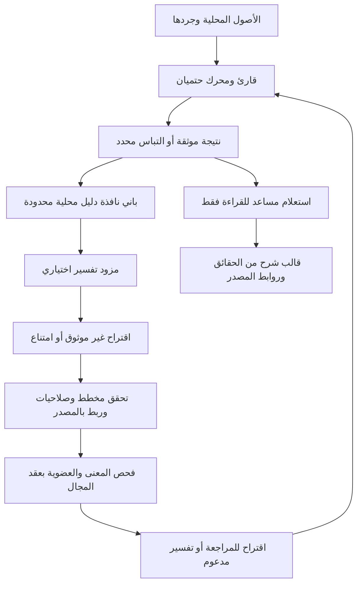

# خطة طبقة الذكاء والمساعد في تراصف

**الحالة: مرجع تصميم وخطة تنفيذ مستقبلية، وليس إعلان تفعيل نموذج جديد.** أُعد في 14 أكتوبر 2026 بعد مراجعة مسارات التفسير الحالية وتجارب المزود. مرجع الصلاحيات المختصر هو [AI وOCR](../reference/AI-AND-OCR.ar.md)، وترتيب العمل هو [خطة المتابعة](../CURRENT-PLAN.ar.md). هذه الوثيقة تفصّل AI-1 وAI-2 وAI-3 وOCR-1 ولا تنشئ مسارًا ينافس خطة صقل المحركات. لا يتغير إصدار التطبيق أو عقده المالي بهذه الدفعة.

## 1. النتيجة التي نريدها

يساعد تراصف المحاسب في فهم ملف غير مألوف، ويقترح تفسير موضع الالتباس، ثم يعرض ما استطاع المحرك إثباته وما بقي بحاجة إلى مراجعة. يستطيع المحاسب السؤال عن الفرق أو معاملة أو سبب عدم المطابقة ويحصل على شرح مربوط بالمصدر. لا يحتاج الاستخدام الأساسي إلى جهاز قوي أو بطاقة رسوم مستقلة أو حساب لدى مزود AI أو مفتاح API أو تثبيت نموذج.

الذكاء هنا وسيلة لتقليل عمل المحاسب لا شرطًا لتشغيل التسوية. نفضل طبقة صغيرة متخصصة نافعة على نموذج عام كبير يعطل جهاز الشركة. لا نعد بفهم كل ملف، أو بانعدام الهلوسة، أو بوجود استدلال توليدي قوي على كل جهاز. نعالج هذا التعارض بتضييق المهمة وبمسار أساسي مفيد دون نموذج، لا بإرسال الملفات للسحابة أو إخفاء متطلبات التشغيل.

## 2. أين وصلنا فعلًا

| الجزء | الدليل القائم | حدّه الحالي |
| --- | --- | --- |
| شرح أدلة المورد | [assistant.ts](../../lib/reconciliation/assistant.ts) | شرح وحجج وفحص فرضيات وفق الأسئلة والأدلة التي يدعمها التنفيذ؛ ليس محادثة عامة |
| شرح المجالات الأخرى | [domain-assistant.ts](../../lib/reconciliation/domain-assistant.ts) | يعيد حساب نتيجة المجال للتحقق؛ لا يمنح بذلك موافقة مالية أو يتجاوز إعادة قراءة الأصل |
| فهم السؤال بنموذج المتصفح | [local-ai.ts](../../lib/reconciliation/local-ai.ts) | اختياري، يتطلب `available`، سؤال إنجليزي محدود؛ الأسئلة العربية لا تدخل هذا المسار. الناتج توجيه مضبوط وليس نص النموذج الحر |
| اقتراح دور عمود | [local-import-ai.ts](../../lib/reconciliation/local-import-ai.ts)، [import-proposals.ts](../../lib/reconciliation/import-proposals.ts) | أعمدة موجودة وأدوار غير محسومة، ربط بالمصدر والقراءة؛ قبول بنيوي بحالة `needs-review` وليس إثبات معنى العمود أو تطبيقًا تلقائيًا |
| تجربة استدلال محلي | [العقد الأول](../../audit/local-provider/contract.json)، [المقترحات والشات v2](../../audit/local-provider/proposal-v2/contract.json)، [تجربة المتصفح](../../audit/local-provider/browser-v1/contract.json) | تجارب تطوير اصطناعية؛ `productEnabled: false` في العقدين الأخيرين. تشغيل runtime لا يثبت قبولًا دلاليًا أو جهازًا ضعيفًا فعليًا |
| قراءة الصور | [خطة OCR وحدودها](../reference/AI-AND-OCR.ar.md) و[الحالة](../reference/STATE.ar.md) | مراجعة مرئية محدودة؛ الإخفاقات الرقمية العربية محفوظة، ولا توجد قراءة مالية تلقائية شاملة للصور |

تحفظ [ذاكرة التطوير](../reference/DEVELOPMENT-LESSONS.ar.md) تجربة اقتراحات خام خاطئة منعتها الحواجز. هذا دليل على أهمية الحاجز، وليس دليلًا على جودة الاقتراح. لا نعد تغيير fixtures أو قواعد القارئ «تدريبًا للنموذج». التدريب الفعلي يحتاج بيانات مأذونًا بها وعقدًا وتقييمًا منفصلًا، وليس جزءًا من هذه الدفعة.

## 3. القواعد التي لا يغيرها أي مزود

1. **المحرك مصدر الحقيقة المالية.** النموذج لا يكتب إلى الأصول أو النتيجة أو سجل الموافقات أو ملف Excel المالي.
2. **الدليل قبل الثقة.** درجة ثقة النموذج أو اتفاق نموذجين أو JSON صحيح أو مجموع متوازن لا يثبت معنى عمود أو عضوية حركة.
3. **المعلومة غير القابلة للإثبات تبقى فرضية.** تأكيد المحاسب يسجل قرارًا بشريًا ولا يصبح دليلًا آليًا مستقلًا بأثر رجعي.
4. **الخصوصية جزء من المعمارية.** لا إرسال لمحتوى الملفات أو السؤال أو المراجع أو البصمات أو الملخصات أو embeddings إلى طرف خارجي للاستدلال أو التحسين أو القياس.
5. **المسار الأساسي يعمل دون AI.** عدم توفر مزود، أو ذاكرة، أو دعم لغة، أو شبكة لا يمنع المقارنة والمراجعة والشرح الحتمي والتصدير ضمن نطاقها المدعوم.
6. **لا تكرار للموافقة العامة.** نستخرج الصريح، ونطلب حسم نقطة مؤثرة فقط، مع عرض الموضع والأثر. الخيارات المتقدمة لا تخفي دليلًا محاسبيًا لازمًا.
7. **كل مجال يحفظ عقده.** تفسير وصف في البنك لا يمنح صلاحية إكمال أرصدة، وربط صنف لا يثبت تقييم مخزون أو سياسة تكلفة.
8. **الأصل والأخطاء والمنافسون باقون.** لا إسقاط صف غير مقروء أو بديل متساوي المبلغ لإظهار تطابق وحيد. العزل الجزئي مشروط بعقد المجال ودليل نطاق الضرر.

## 4. المعمارية المستهدفة وحدود الثقة

السهم إلى المحرك يعيد الفحص من المصدر؛ لا يستدعي `approve` ولا يغير الحالة بمفرده. الجلسة المالية وقواعدها مستقلة عن جلسة النموذج. إعادة النتيجة الحتمية بالأصل والإعدادات نفسيهما يجب أن تبقى قابلة للتكرار حتى لو اختلف اقتراح AI.

تقسم المسؤوليات المقترحة إلى: محول مزود محلي، باني سياق، مخطط اقتراح، مدقق صلاحيات وربط، مدقق خاص بالمجال، استعلام شرح، وسجل أثر. نعيد استعمال الشفرة القائمة حيث تؤدي المعنى نفسه بدل إنشاء محرك موازٍ. تبقى حدود هذه الوحدات مقترحة حتى تدخل بطاقة تنفيذ واختبار.

يُشغّل الاستدلال بعيدًا عن خيط الواجهة عند سماح runtime، مع طلب واحد نشط وإلغاء ومهلة. **Web Worker وسيلة عزل عمل وموارد، وليس وحده حاجزًا يمنع الشبكة أو مكتبة خبيثة**؛ إذ يمكن للعامل تنفيذ اتصالات. نحتاج سياسة موارد متوافقة مع الاستضافة، واعتمادات محلية مثبتة، وفحص اتصالات العامل والصفحة وruntime. لا نزعم أن اعتراض الطلبات في اختبار متصفح يثبت عزلة نظام التشغيل أو إضافات المتصفح.

## 5. ما يقرأه AI وما يستطيع إرجاعه

| المهمة | ما يرسل محليًا إلى المزود | الناتج المسموح | ما يحسمه المحرك أو المراجع |
| --- | --- | --- | --- |
| معنى عمود غير مألوف | رؤوس أصلية وسياق أقسام وعينات محدودة مع مواضعها والأخطاء | دور من قائمة المجال ورقم عمود موجود وأدلة أو امتناع | دور العمود الحقيقي، اختلاف مبلغ/رصيد/كمية، الإشارات والعملات؛ الخريطة الملتبسة تبقى للمراجعة |
| وصف دفع أو إشعار أو احتجاز | النص والمرجع والسياق المتاح من المصدر | نوع محتمل وربط بالمقطع الذي استند إليه | لا تغيير مالي من الوصف وحده، ولا توليد رسوم أو خصم |
| عملية تقابل عدة أسطر | مجموعة مرشحين موثقة وحدود بحثها وعلاقاتها | معرفات موجودة وعلاقة مقترحة | العضوية والمنافسون والسعة وعدم إعادة الاستخدام والأبعاد والفترة والدليل المستندي |
| تخطيط صورة أو PDF معقد | قصاصة محدودة مع إحداثيات الأصل وجرد مناطقها | مناطق أو نص قراءة بديل منفصل عن الحقائق | فحص الحقول الأصلية وفق عقد OCR؛ القراءة المرئية احتمالية وليست أرقامًا مثبتة |
| سؤال عن النتيجة | السؤال ونافذة أدلة النتيجة الحالية | نية سؤال ومعرفات ذات صلة أو امتناع | تنفيذ استعلام مسموح للقراءة وصياغة جواب مالي من نتائج المحرك |

لا يحصل المزود على حالة التطبيق كاملة أو ملفات بقية التسويات أو تفاصيل الهوية والحساب أو مخازن المتصفح أو أدوات shell أو الشبكة أو SQL أو دوال ترحيل. لا نعطيه مفتاحًا ثم نعتمد على عبارة «لا تستخدمه» في prompt. لا ننفذ شفرة أو تعبيرًا أو صيغة أو رابطًا يصدره النموذج.

تقليل البيانات ليس إخفاء دليل: إذا حذف السياق المنافس أو اقتطع المجموعة المطلوبة لملاءمة الميزانية، يوصف السياق بأنه غير كامل، ويمنع الاستنتاج الذي يحتاج اكتماله. يرفض النظام اعتبار الاقتراح فريدًا لمجرد أن البدائل لم تُرسل للنموذج. المحرك يفحص المنافسين على فهرس المصدر الكامل داخل النطاق المسموح، أو يعلن أن البحث لم يكتمل.

## 6. عقد الاقتراح وحالاته

هذا **عقد مستهدف** لتوحيد التوسعات، وليس وصفًا لنوع TypeScript مطبق الآن. لا نغير البروتوكولات القديمة بأثر رجعي.

| الحقل | المعنى والتحقق |
| --- | --- |
| `schemaVersion`, `taskKind`, `domain` | إصدار معروف ومهمة ومجال من قوائم مغلقة |
| `requestId`, `contextRevision`, `resultRevision` | الطلب والسياق والنتيجة الحالية؛ تُرفض الردود المتأخرة أو التابعة لجلسة أخرى |
| `sources` | معرف المصدر ودوره وبصمة الأصل وإصدار القراءة والإعدادات المؤثرة؛ تحقق من البايتات عند حدود القرار |
| `evidenceRefs` | ورقة وصف وعمود أو صفحة ومستطيل ومقطع نص؛ كل مرجع موجود ومملوك للمصدر المقصود |
| `proposal` | اتحاد حسب المهمة: دور عمود، معرفات أعضاء، تصنيف، أو نية سؤال؛ لا حقول مالية جديدة أو موافقات |
| `contextCoverage` | نطاق النافذة وما اقتطع أو لم يفحص؛ يحدد النظام ذلك ولا يصدّق وصف النموذج للاكتمال |
| `abstain`, `reasonCode` | امتناع صريح وأسباب مقيدة؛ النص التوضيحي غير الموثوق لا يكتسب سلطة |

تُرفض الحقول الزائدة والأنواع الخاطئة والازدواج والتجاوز الحجمي والمعرفات الأجنبية. مخطط OCR مستقل يسمح بقراءة نصية بديلة موسومة بوضوح، ولا يسمح بتمريرها كـ`amount` معتمد عبر عقد الاقتراح الدلالي. يمنع ذلك الالتفاف على قاعدة عدم اختراع المال بإعادة تسميته تفسيرًا.

الحالات المقترحة: **غير متاح → قيد التحليل → مقترح / ممتنع / مرفوض / منتهي الصلاحية**. نجاح فحص الصيغة والربط يعني «اقتراح قابل للفحص»، ثم يأتي فحص المعنى. إذا لم يوجد شاهد مستقل يحدد المعنى يبقى `Needs Review` ولو صح الحساب. لا توجد حالة `AI Approved`. التطبيق التلقائي المستقبلي لأي تفسير يحتاج قاعدة حتمية مثبتة وعقد مجال واختبارات مستقلة؛ نجاح النموذج وحده لا يفتح هذا المسار.

كل تغيير في الملف، حدود أعمدة PDF، خريطة القراءة، العملة، الدقة، القطع الزمني، المجال، أو قرار سابق مؤثر يبطل الاقتراح المرتبط به. إلغاء الطلب يمنع وصوله المتأخر من إحياء الحالة. الحفظ والاستعادة والتصدير يعيد التحقق؛ سجل AI تاريخ قرار وتفسير، لا مصدرًا بديلًا للأصل.

## 7. مثال العضوية الذي يجب ألا نفشل فيه

لدى الشركة حوالة 1,000، ولدى الطرف الآخر أربع حركات: 500 مرتبطة بالحوالة نفسها، و500 تخص فاتورة أخرى، و300 و200 مرتبطتان بالحوالة الأصلية. الجمع 500 + 500 صحيح حسابيًا لكنه ربط خاطئ. يمكن للنموذج أن يقترح المجموعة 500 + 300 + 200 من الوصف، لكن لا نعتمدها حتى يثبت المرجع أو إشعار التسوية والعلاقات عضويتها، مع فحص جميع البدائل والسعة المتبقية.

إذا لم تميز الملفات المجموعتين، الإجابة الصحيحة «توجد مجموعات متساوية ولا تكفي الأدلة للحسم» مع بيان المستند المطلوب. لا يتولد مرجع وهمي أو رسم يوازن المجموعة. يشمل الاختبار حالة تقلب فيها عضوية عضوين مع بقاء المجاميع كلها صحيحة؛ يجب أن يكشف خطأ الربط، وأن ينجح أيضًا المثال الإيجابي المثبت.

## 8. الشات الذي نريده

المسار المستهدف: **سؤال عربي أو إنجليزي → نية ومعرفات → استعلام قراءة مسموح → حقائق المحرك وأدلتها → شرح واضح**. يمكن فهم الأسئلة الشائعة بقواعد محلية؛ النموذج يوسع فهم الصياغة عند توفره، ولا يعيد حساب الأرقام أو يؤلف السبب.

الأولوية لقوالب شرح مرنة تغطي الفرق، المعاملة، غير المتحقق، والخطوة التالية. لا نبدأ بنص توليدي حر عن المال ثم نحاول إصلاحه بفلتر أرقام؛ قد يستخدم النموذج رقمًا صحيحًا وينسبه إلى فاتورة أو سبب خاطئ. لو أضفنا إعادة صياغة مستقبلية، يكون الناتج بنية ادعاءات ومعرفات حقائق وأسباب من قوائم معتمدة، ويُركّب النص من قيم المحرك. أي ادعاء جديد أو علاقة سببية غير مثبتة يعيدنا إلى القالب الموثق.

| السؤال | طريقة الإجابة |
| --- | --- |
| لماذا يوجد فرق 50,000؟ | التحقق من أن هذا الفرق موجود في النتيجة الحالية وعملتها ونطاقها، ثم تفصيل مكوناته المثبتة وما لم يفسر. لا افتراض أنه رسوم أو فاتورة مفقودة |
| لماذا لم تطابق الفاتورة؟ | تحديد الفاتورة الفعلية؛ إن تكرر المرجع نسأل أيّها، ثم نعرض القاعدة أو المنافس أو نقص الدليل مع موقعه |
| ما الذي أراجعه الآن؟ | أولويات من حالات المحرك وأثرها وحدود التغطية، مع انتقال مباشر إلى موضع المراجعة |
| هل انتهت التسوية؟ | الحالة التي يسمح بها عقد المجال: مقارنة حركات أو تحقق أرصدة أو مراجعة ناقصة. صفر فرق لا يعني تلقائيًا اكتمال التسوية |
| اعتبرها متطابقة أو تجاهل الفرق | يشرح الشات ما يمنع ذلك؛ لا ينفذ قرارًا. قرارات المحاسب تمر بالواجهة المخصصة وإعادة التحقق |
| هل أرى تلاعبًا أو مشكلة ضريبية؟ | يبين الشواهد المحاسبية المتاحة وحدودها؛ لا يتهم جهة ولا يصدر رأيًا نظاميًا أو شهادة تدقيق من فرق غير مفسر |

الجواب يحتوي خلاصة قصيرة، المبلغ والعملة إن لزما من المحرك، رابط الدليل، والسبب وما ينقص. لا نعرض chain-of-thought أو ندعي أنها دليل تدقيق؛ نعرض القواعد والحقائق القابلة لإعادة الفحص. تاريخ المحادثة ليس مصدر حقيقة؛ السؤال عن نتيجة قديمة يوسم تاريخيًا أو يطلب اختيار النتيجة، ولا يختلط بنتيجة جديدة.

لا نساوي عرض العربية بقدرة النموذج على فهمها. القبول منفصل للعربية والإنجليزية والمحتوى المختلط، والأرقام العربية واللاتينية، والمراجع المتشابهة. الإخفاق في فهم سؤال لا يبطل صحة التسوية ولا يطلب من المحاسب إعدادات نموذج.

## 9. الخصوصية والأمان ودورة حياة البيانات

| البيانات | السياسة المستهدفة |
| --- | --- |
| الملفات والأرقام والنصوص والقصاصات والسؤال والإجابة وembeddings والبصمات | تبقى داخل جلسة الجهاز؛ لا تدريب أو تحسين مركزي أو قياس استعمال بها |
| سياق المزود المؤقت | أقل نافذة كافية، لا ضم جلسات أو شركات مختلفة؛ تحرير المراجع وإنهاء جلسة المزود عند الإلغاء أو المغادرة |
| حفظ المحادثة أو قوالب المستخدم | ليس افتراضيًا؛ إن احتجناه لاحقًا يكون محليًا صريحًا وله حذف واضح وإبطال ربط المصدر، ولا تنتقل مع حساب الشركة تلقائيًا |
| ملف جلسة أو Excel يصدره المحاسب | يحتوي بياناته وأثره حسب العقد؛ تصدير صريح. لا نزعم تشفيره أو إمكانية محوه بعد تنزيله |
| أصول نموذج اختياري | حزمة ثابتة محلية أو مستضافة بأسماء ثابتة وبصمات وترخيص، دون معرفات عملاء في URL؛ سياسة تخزين ومسح منفصلة عن البيانات المالية |
| سجل التشخيص | أكواد عامة وإصدارات ومدة عند الحاجة محليًا؛ لا prompts أو صفوف أو أسماء ملفات في console أو تقارير أخطاء مرسلة |
| لوحة المالك والحسابات المستقبلية | وفق [ACC](accounts-privacy-business.ar.md) فقط؛ لا محتوى الشات ولا عدد أخطاء عميل مالي ولا معرفاته المالية ولا نتائج شركاته |

تحميل صفحة الويب وأصولها اتصال بالخادم، وقد يسجل المضيف بيانات اتصال معتادة؛ لذلك عبارة «لا توجد أي اتصالات أو بيانات محفوظة مطلقًا» غير صحيحة. الوعد المقصود: لا ترفع ملفات التسوية ومحتواها للاستدلال أو التحليل، ولا تحفظها خوادم تراصف ضمن هذا المسار. تبقى إدارة الجهاز والنسخ الاحتياطي والإضافات وسياسات المتصفح خارج ضمان المحو الكامل. تحرير ذاكرة JavaScript ليس وعدًا بمسح آمن لكل بايت من RAM أو القرص.

يُفحص كل مزود من ناحية الترخيص وملفات النموذج وruntime ومصادر تحميله والتحديثات والاتصالات. وجود API باسم «local» أو نتيجة `available` وحدهما لا يكفيان. إذا تعذر إثبات الحد المطلوب يبقى المزود مغلقًا. لا نحمّل runtime من CDN ولا نسمح له بجلب نموذج جديد أو fallback سحابي تلقائيًا. أي استدلال خارجي مستقبلًا تغيير مستقل في توجه المنتج يحتاج قرارًا وموافقة وتصميم خصوصية جديدًا؛ ليس مفتاحًا مخفيًا لهذه الخطة.

المصدر والسؤال نصوص غير موثوقة: «تجاهل التعليمات» داخل خلية أو صورة أو وصف لا يغير الصلاحيات. نفحص مخططات البيانات وملكية المراجع عند العودة، ونعرض النص مهربًا دون HTML خام أو روابط تنفذ أوامر أو صيغ Excel. نعطل جلب روابط المستندات والموارد المضمّنة. السياق التاريخي لا يحمل أوامر نظام ولا صلاحيات.

تستهدف اختبارات الخصوصية الطلبات من الصفحة والعامل والمزود، وfetch وXHR وWebSocket وbeacon وروابط الموارد وطلبات الصور والتشخيص، والسلوك عند الفشل. تستخدم بيانات اصطناعية مميزة لكشف التسريب، قبل وبعد تعطيل الشبكة، مع فحص التخزين المؤقت وIndexedDB وlocalStorage وملفات التنزيل. نتيجة الاختبار تصف حدود الرصد ولا تدعي مقاومة جهاز مصاب.

## 10. أجهزة الشركات العادية وخفة التشغيل

نبدأ بالمسار الحتمي واستعلامات الشرح الصغيرة. عند التباس محدود نجرب مصنفًا صغيرًا أو نموذجًا محليًا متخصصًا؛ لا نفترض أن نموذج محادثة عام أو نموذج رؤية كبير هو الحل الأول. التكميم وتقليل السياق خيارات قياس، وليسا ضمان دقة أو ترخيصًا لقبول أخطاء جديدة.

**الأرقام التالية ميزانية تجربة جديدة مقترحة يجب تثبيتها قبل تشغيلها، وليست نتائج مقاسة أو حدًا قائمًا في المنتج.** لا تعدّل حدود العقود التاريخية لتظهر أنها اجتازتها.

| العنصر | ميزانية البداية وبوابة القرار |
| --- | --- |
| جهاز القبول الأساسي | جهاز أعمال فعلي Windows بذاكرة 8 GiB ومعالج عادي دون GPU مستقل، مع تطبيقات المكتب المعتادة؛ توثيق المعالج والمتصفح ونسخته والذاكرة المتاحة |
| جهاز الضغط | جهاز فعلي 4 GiB أو بيئة مؤسسية مقيدة؛ يجب بقاء المسار الحتمي والشرح الأساسي قابلين للاستخدام، ويجوز عدم تشغيل النموذج |
| أجهزة إضافية | متصفحان مؤسسيان مستهدفان على الأقل وفق سياسة الشركة؛ يُسجل الدعم لكل متصفح ومزود، ولا يُستنتج من تشغيل Node أو جهاز حديث |
| حجم الإضافة | صفر بايت أوزان نموذج مطلوب للمسار الأساسي؛ هدف التجربة الاختيارية ≤ 64 MiB نقل إجمالي runtime والأوزان والبيانات الإضافية، محسوبًا فوق الأساس |
| الذاكرة | زيادة ذروة ≤ 512 MiB للاستدلال في تجربة الجهاز الأساسي، مع قياس إجمالي التبويب/العامل وحمل القراءة والمطابقة معًا؛ JS heap وحده لا يقيس ذاكرة WASM/GPU |
| زمن الشرح الأساسي | هدف p95 ≤ 500 ms للاستعلام والعرض بعد جاهزية النتيجة ضمن حجم الحالة المحدد |
| زمن الاقتراح | هدف p95 ≤ 5 s بعد الجاهزية، مهلة قصوى 10 s، وعدم تكرار الطلب تلقائيًا. التحميل البارد يقاس منفصلًا ولا يحجز التسوية |
| التحميل والإلغاء | قياس البارد على شبكة موصوفة مع هدف ≤ 15 s إن اختيرت حزمة اختيارية؛ انتهاء المهلة يبقي الأساس. هدف إنهاء عمل الطلب خلال 1 s من الإلغاء دون تطبيق رد متأخر |
| السياق | بدء التجربة بمهمة واحدة، ≤ 8 KiB نص مدخل و≤ 192 token خرج؛ النص العربي يقاس بالبايت والتوكن، لا بعدد الحروف وحده |
| التوازي | استدلال واحد نشط، طابور محدود بلا إعادة محاولات حلقية؛ الأولوية للقراءة والمحرك والتصدير |

لا نعتمد على `deviceMemory` وحده أو تخمين نوع الجهاز؛ قد لا يتوفر أو يكون تقريبيًا. نقيس قابلية التشغيل ولا ننشئ بصمة جهاز تُرسل لخادم. تحدد بطاقة الاختبار أحجام الملفات وعدد التكرارات الباردة والدافئة، p50/p95 والذروة والأعطال والطاقة إن أمكن قياسها، وتفصل النتائج حسب اللغة والجهاز. تقييد خيوط جهاز قوي ليس دليل جهاز ضعيف فعلي.

لا تنزيل نموذج تلقائيًا عند الدخول أو الرفع. المزود الموجود مسبقًا خيار فقط بعد التحقق من حدوده؛ إن احتاجت ميزة لاحقة حزمة إضافية، يظهر حجمها واختيار تحميلها مرة واحدة دون حجب الاستخدام الأساسي، ولا نسمي هذه الميزة «بلا تنزيل». إذا لم نجد نموذجًا مفيدًا داخل الميزانية، نبقيه مغلقًا ونحسن القواعد والشرح أو نضيّق المهمة؛ لا نرفع الميزانية سرًا ولا نجبر المستخدم على جهاز أقوى. مراجعة الميزانية قرار موثق قبل تجربة جديدة.

## 11. الملفات الطويلة والصور

ملف 70 صفحة لا يرسل كاملًا إلى نموذج، ولا يقتطع أول صفحاته ثم يعلن اكتماله. يبدأ القارئ بجرد الصفحات والجداول والصفوف والأجزاء غير المقروءة. يستخدم المحرك فهارس محلية، ثم نرسل للمزود نافذة مرتبطة بمشكلة واحدة مع حدودها. نتائج النوافذ لا تُجمع لتعلن اكتمالًا دون جرد تغطية وموانع ازدواج.

تظل المجموعات العابرة للصفحات والمراجع المتكررة والأرصدة المرحّلة ضمن تحقق المحرك على النطاق الكامل. تجاوز ميزانية البحث أو نقص صفحة يسجل بوضوح؛ لا يسمى «غير مطابق» لمجرد أن البحث لم يصل إليه، ولا «مطابق» لأن نموذجًا اقترح مرشحًا وحيدًا.

الصور مسار OCR-1 مستقل: حفظ الأصل والقصاصات، تحديد المناطق، قراءة مرشحة، ثم تحقق حقلي للأرقام والإشارة والعملة والتاريخ والمرجع والعمود. لا استكمال رقم تحت ختم من السياق أو توليد ناقص أو فاصلة. عند قراءة متعارضة تعرض الخلية الملتبسة مع الأصل؛ إذا كان جرد الصورة نفسه ناقصًا لا نزعم أن مراجعة تلك الخلية وحدها تكفي. معالجة صورة واحدة لا تثبت سعة 70 صفحة، وهذه الخطة لا توسع الحد المرئي الحالي تلقائيًا.

## 12. ربط الطبقة بكل محرك

| المجال | التفسير الذي قد يفيد | حقيقة لا يمنحها AI |
| --- | --- | --- |
| الموردون SUP | مسميات المستندات وعلاقات الفاتورة والإشعار ومكونات الدفع | ملكية المجموعة من تساوي الأرقام أو تشابه الاسم |
| المقاصة CLR | تصنيف الحركة وربط المجموعة الموثقة | اكتمال المقاصة من صافي صفر |
| العملاء AR | هوية الإشعار وتفاصيل كشف العميل | تسوية دين أو إسقاط متبقي بلا مستند |
| الأستاذ وTB GLT | معنى الأقسام وعناوين الحسابات | دمج عملات أو أبعاد أو فترات مختلفة |
| تخصيص الدفعات ALL | تفسير إشعار الحوالة وتخصيصاته الصريحة | توزيع مبلغ على فواتير بلا دليل أو تجاوز المتبقي |
| البنك BNK | تمييز أصل التحويل ورسومه ووصف البنك | اختراع رسم من الفرق أو إثبات رصيد دون افتتاح وتغطية وقطع |
| TB والقوائم FIN | تفسير علاقات عناوين العرض | حساب الأب والابن معًا أو تخمين تصنيف مالي ملزم |
| الشركات الشقيقة IC | مسميات الأطراف والمراجع الداخلية | تقاص شركات أو عملات أو فترات مختلفة بلا سياسة |
| بوابات الدفع PG | معنى مكونات التسوية والمرتجعات | استنتاج عمولة أو ضريبة أو تحويل عملة من صافي الإيداع |
| المخزون INV | أدوار الحقول والأقسام والأبعاد المصرح بها | تخمين وحدة/كمية/دفعة/مستودع أو توليد تقييم أو تكلفة |
| الأصول FA | تفسير مكونات الحركة ومسميات الأصول | احتساب إهلاك أو العمر أو الإضافات دون عقد وسياسة |
| الرواتب PAY | معنى مكون المسير ومراجع الدفعات | جمع موظفين متشابهين أو إسقاط مكونات أو إثبات الصرف دون مصدر |

كل تكامل له حالات إيجابية وسلبية وعقد ومخرج مستقلان. لا نربط المزود بكل المجالات مرة واحدة، ولا ننقل تصريح اقتراح المورد إلى المخزون لمجرد أن شكل JSON متشابه.

## 13. كيف نقيس المنفعة والهلوسة

نفصل أربع مراحل في التقرير: **اقتراح خام، اقتراح اجتاز الربط البنيوي، تفسير مثبت أو مراجع، أثر مالي نهائي**. صفر أخطاء في المرحلة الأخيرة قد ينتج عن رفض الجميع؛ لذلك نقيس النجاح المفيد والامتناع الصحيح والعمل الذي بقي للمحاسب أيضًا.

| المقياس | الحساب أو بوابة القبول |
| --- | --- |
| دقة الاقتراح الخام | الاقتراحات الصحيحة / جميع الاقتراحات غير الممتنعة، مع عدد الحالات الكلي؛ لا نخفي الخطأ الذي منعته الحواجز |
| تجاوز الصلاحية أو تسرب مالي | صفر في مجموعة القبول؛ أي حالة توقف تفعيل المرشح وتفتح إصلاحًا |
| ادعاء مثبت كاذب أو مطابقة خاطئة | صفر في مجموعة القبول المالية المستقلة، مع نشر عدد الفرص والأنواع؛ ليس ضمانًا عامًا بنسبة 100% |
| التغطية المفيدة | الحالات المؤهلة المنجزة صحيحة / الحالات المؤهلة المحددة قبل التشغيل، منفصلة عن Scope Fit |
| الامتناع | صحيح في الحالات المستحيلة أو المتعارضة، وخاطئ في الحالات التي تكفي أدلتها؛ يسجل النوعان |
| الشرح | صحة المبلغ والعملة والهوية والسبب والحالة ومواقع الدليل معًا، وليس مجرد تطابق النص أو الرقم |
| القيمة الإضافية | مقارنة المحرك وحده بالمحرك مع الطبقة على نفس الحالات؛ الهدف العددي الأدنى للفائدة يثبت قبل التجربة ولا يُختار بعد النتائج |
| عبء المحاسب | عدد التصحيحات والإقرارات والتنقلات والزمن؛ القياس الآلي مؤشر فقط، وادعاء توفير وقت ميداني يتطلب مستخدمين فعليين |
| الأداء | حدود القسم 10 على الأجهزة الفعلية والحمل المحدد؛ لا اعتماد على متوسط جهاز المطور فقط |

تشمل مصفوفة الاختبار مصادر مختلفة فعليًا: PDF نصي وجدول متعدد الصفحات، صورة بمسح مختلف، Excel أفقي وعمودي ومقسم ومصفوفة وخلايا مدمجة، CSV بأقسام وترويسات متكررة؛ يختبر كل منها فقط عندما يدخل نطاق الدفعة بعقد واضح. اختلاف المنتج والتصميم وموضع المعنى أهم من تبديل الأرقام. لا ندعي دعم كل العائلات لمجرد وجودها في خطة الاختبار.

نثبت الحقيقة من المصدر مستقلًا عن القارئ والنموذج، ونحتفظ بالبايتات والإحداثيات. تفصل مجموعات التطوير والتحقق والـholdout حسب عائلة التصميم والمنتج والقالب والقصة، لا تقسيم صفوف القصة نفسها عشوائيًا. بعدما نصلح حالة فاشلة تصبح انحدارًا معروفًا؛ لا تعود holdout. لا ينشئ النموذج الذي نقيسه الحقيقة ثم يحكم على نفسه.

الحالات الهجومية المطلوبة: مجموعات متساوية وأعضاء خاطئون، مراجع مكررة، فروع وعملات مختلفة، حقل صحيح المعنى ظاهريًا لكنه رصيد أو تاريخ استحقاق، ناقص/صفر/فراغ/ثلاث منازل، سجل طويل يخفي المنافس خارج النافذة، حقن تعليمات في رأس أو خلية أو صورة، سؤال يحمل مبلغًا خاطئًا، رد متأخر، تغيير المصدر أثناء الاستدلال، نموذج غير متاح، انقطاع الشبكة، نفاد ذاكرة، JSON زائد الصلاحية، رابط خبيث، وجلسة مستعادة بأدلة متغيرة.

الطفرات المطلوبة تعطل عمدًا ربط المصدر أو فحص العضوية أو حدود السياق أو تصنيف الفرضية أو منع كتابة القرار؛ يجب أن يفشل شاهد مستقل بسبب المعنى المالي، لا بسبب خطأ استيراد أو تشغيل. التصدير يثبت القيم والأبعاد والعضوية والاستشهادات وحالة الاقتراح وقرار المحاسب. لا يحول الشات عبارة «قد تكون رسومًا» إلى بند مصالحة في Excel.

## 14. دفعات التنفيذ وبوابات التوقف

| الدفعة | العمل المحدد | شرط الإغلاق |
| --- | --- | --- |
| AI-1a جرد وعقد | جرد الاختبارات الحالية، اختيار التباس واحد لم تحله القواعد، تثبيت الصلاحيات والسياق والأوراكل والموارد | فجوة مثبتة ومجموعة بنيوية جديدة وحدود واضحة؛ لا تكرار لما يغطيه الاختبار القائم |
| AI-1b محول اقتراح | بناء النافذة والمدقق والامتناع والإبطال وسجل الأثر بمزود وهمي عدائي | لا سلطة مالية أو اتصال أو رد أجنبي؛ هذا يثبت الحواجز فقط، لا ذكاءً دلاليًا |
| AI-2a تجربة مزود صغير | استدلال فعلي لنفس المهمة على المتصفح والجهاز العادي والعربية والإنجليزية | فائدة محددة مسبقًا، حدود موارد، مصدر وترخيص مثبتان، وصفر خرق؛ فشلها يبقي المزود غير مفعّل |
| AI-1c تكامل مجال واحد | اقتراح مفهوم ومراجعة موضعية وإعادة قراءة وحساب وحفظ واستعادة وExcel | إثبات الأثر المالي والعضوية والأبعاد كاملة من المصدر عبر دورة الاستخدام |
| AI-3a مساعد موثق | توسيع استعلامات الشرح الحتمية والصياغة العربية والإنجليزية وروابط الدليل | أسئلة واقعية وملتبسة تعطي جوابًا صحيح النطاق أو تطلب تحديدًا بسيطًا |
| AI-3b فهم السؤال اختياريًا | توجيه السؤال الحر محليًا إلى استعلامات مغلقة وإبطال السياق القديم | تحسن فهم مقاس دون أي ادعاء مالي جديد؛ القالب الأساسي يعمل عند الفشل |
| OCR-1a ثم OCR-1b | نطاق بصري واحد، حقيقة من البكسلات، مراجعة حقول، ثم تكامل مجال محدد | دقة الحقول والجرد والأثر المالي مثبتة؛ لا توريث نتائج PDF النصي للصورة |
| AI-G توسع مضبوط | نقل المهمة المفيدة إلى مجال أو بنية أخرى بعقد مستقل | نجاح البوابة الخاصة بالمجال والحمل؛ لا تفعيل شامل تلقائي |

تحدد بطاقة كل تجربة الساعات والكلفة وعدد المزودين والمحاولات ومجموعة الأجهزة قبل البدء. توصية البداية: مهمة واحدة ومزود واحد وثلاثة أيام هندسية كحد تجربة، ثم قرار **استمرار محدد / تغيير نطاق / إيقاف المزود**؛ ليست وعد موعد أو تمديدًا تلقائيًا. لا نستهلك الوقت بتجربة نماذج كثيرة بلا شاهد فائدة.

AI-3a يمكن تنفيذه دون انتظار نموذج مفيد؛ أما الاستدلال الاختياري فلا يصبح شرطًا للشرح. تنسيق هاتين الدفعتين يخضع لخطة المتابعة ولا يزاحم إصلاح خطر مالي قائم. الحالات التي تستلزم استيضاحًا من المورد قد تكون غير قابلة للحسم من الملفين أصلًا، وهذه حدود معلومات وليست مشكلة نعالجها بنموذج أكبر.

## 15. التفعيل والتراجع والقرارات المفتوحة

يبدأ كل مزود ومهمة ولغة ومجال بمفتاح تفعيل مغلق. قرار التفعيل يرتبط ببصمة النموذج وruntime وإعدادات التوليد والعقد والجهاز والمتصفح ومجموعة القبول؛ تحديث أي منها يحتاج إعادة تقييم الجزء المتأثر، ولا يرث نجاح إصدار قديم. لا نعتمد على temperature=0 كبرهان حتمية كاملة للاستدلال؛ نعيد تشغيل الحالات الحرجة ونطلب ثبات السلطة المالية ولو اختلف الاقتراح.

تدرج التفعيل: تجربة تطوير اصطناعية، ثم تجربة محلية محدودة بعد اجتياز البوابات، ثم إعلان نطاق الميزة بدقة. مع بقاء فجوة الأجهزة الفعلية أو الفائدة الميدانية مفتوحة تبقى التجربة موسومة ولا تسوّق كقدرة مثبتة عامة. يتوفر تعطيل المزود والعودة إلى الشرح الحتمي دون حذف الملف أو النتيجة أو قرارات المحاسب. لا يتطلب التراجع قراءة ملفات العميل على خادم، ولا يرسل سبب التعطيل المالي إلى لوحة المالك.

القرارات التي يجب حسمها بالأدلة قبل التنفيذ العام: المهمة الأولى ذات المنفعة، اختيار المزود والترخيص، قائمة المتصفحات والأجهزة، الميزانية المثبتة للدفعة، نسبة التحسن الأدنى، ودعم العربية الفعلي. لا يوجد في هذه الوثيقة نموذج معتمد نهائيًا. تُراجع سياسة منع الاتصالات مع قيود GitHub Pages والاستضافة قبل اختيار آلية CSP أو عزل runtime؛ لا نوثق ترويسات أمان لا تستطيع الاستضافة تطبيقها كأنها مفعلة.

## 16. بطاقة تسليم لأي مطور أو AI لاحق

قبل الكتابة اقرأ [AGENTS](../../AGENTS.md)، [الحالة](../reference/STATE.ar.md)، [المحاسبة](../reference/ACCOUNTING-CONTRACT.ar.md)، [تنوع المصادر](source-diversity.ar.md)، والعقد الخاص بالمجال. راجع الاختبارات الموجودة مثل [local-ai](../../tests/local-ai.test.ts)، [سياق المساعد](../../tests/local-ai-context.test.ts)، [اقتراح الاستيراد](../../tests/import-proposals.test.ts)، [المزود المحلي](../../tests/local-provider-contract.test.ts)، و[الهجمات على المساعد](../../tests/assistant-adversarial.test.ts)؛ هذه روابط بداية وليست ادعاء أنها تغطي الخطة كاملة أو أُعيد تشغيلها بهذه الدفعة.

تحتوي بطاقة التنفيذ على:

- معرف الدفعة وأساس Git والفجوة المحددة وما يراه المحاسب اليوم وما سيتحسن.
- المهمة واللغة والمجال وعائلات المصادر ونطاق السياق وما لا يدعمه المرشح.
- مصدر الحقيقة المستقل وبصمات المدخلات والـholdout وحدود الصلاحيات والخصوصية.
- المزود وإصدار runtime والبصمات والترخيص وإعدادات التوليد؛ لا اختيار على السمعة أو عدد المعاملات وحده.
- الأجهزة الفعلية وأحجام النقل والذاكرة والزمن والمهل والإلغاء والتخزين والاتصالات المسموحة.
- صحة الخام والمقبول والمخرج المالي والامتناع والعبء البشري، مقارنة بالمسار الحتمي.
- النتائج الفاشلة كما حدثت، وأثر التعديل في الجلسة والعامل وExcel والواجهة الموحدة.
- الملفات التي تغيرت والفحوص المنفذة والرأس وCI وحالة النشر الفعلية، والقرار التالي.

لا تخزن بيانات المستخدم أو prompts الخاصة أو لقطات التقارير الحقيقية في GitHub. ينشر العقد والشفرة والعينات الاصطناعية المراجعة والملخص الآمن فقط، وفق [دليل التسليم](../reference/DELIVERY.ar.md). لا تغيّر نسخة التطبيق لتعديل هذه الخطة، ولا تصفها على صفحة الموقع كميزة جاهزة. المرجع يحفظ اتجاه تراصف: **تفسير محلي محدود ونافع، وقرار مالي قابل للتحقق، وتجربة بسيطة على الأجهزة العادية**.
